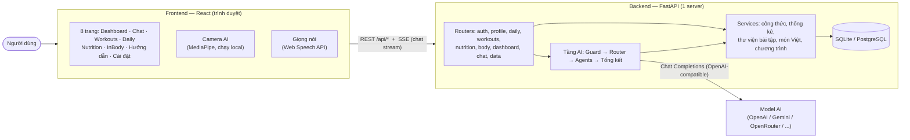
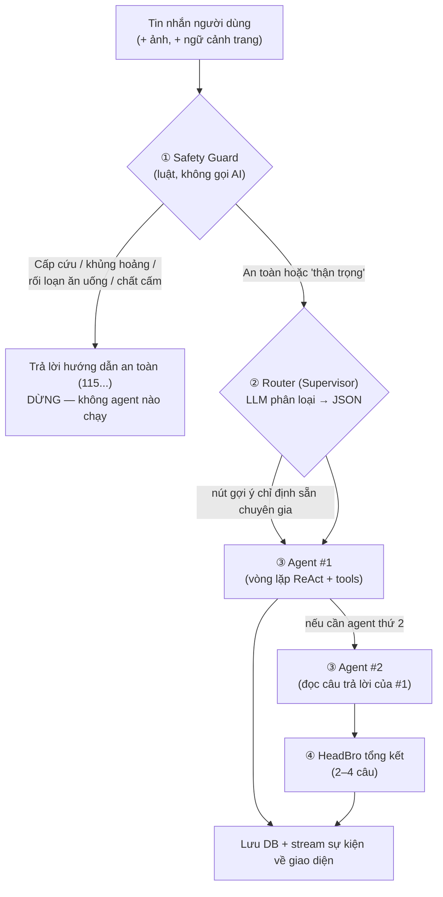
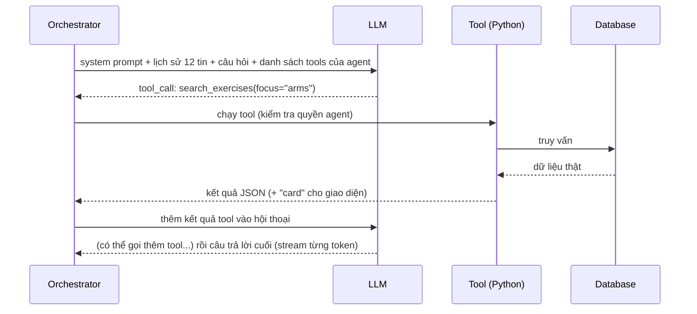
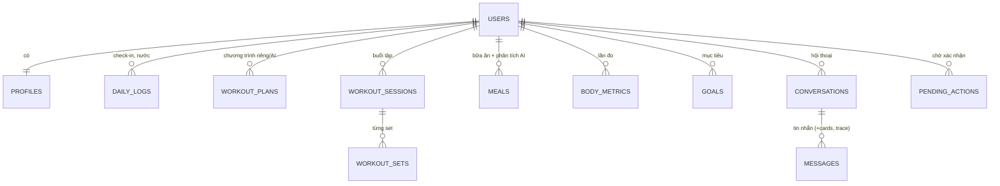

# FitBro AI — Tài liệu giải thích toàn bộ hệ thống

> Phiên bản 3.1 (viết lại từ đầu dựa trên mã nguồn `AI_FITBRO_SOURCE_CODE.rar` và tài liệu feedback của nhóm).
> Đọc theo thứ tự: mục 1–2 để hiểu **vì sao viết lại**, mục 3–6 để hiểu **hệ thống AI hoạt động thế nào**, mục 7–10 để hiểu **dữ liệu, công thức, giao diện**, mục 11–13 để **chạy, deploy, bảo vệ đồ án**.

---

## Mục lục

1. [Tổng quan](#1-tổng-quan)
2. [Bản cũ có vấn đề gì & đã sửa thế nào](#2-bản-cũ-có-vấn-đề-gì--đã-sửa-thế-nào)
3. [Kiến trúc tổng thể](#3-kiến-trúc-tổng-thể)
4. [Hệ thống đa tác tử (multi-agent) — phần quan trọng nhất](#4-hệ-thống-đa-tác-tử-multi-agent)
5. [Bộ công cụ (tools) của từng agent](#5-bộ-công-cụ-tools-của-từng-agent)
6. [Các tác vụ AI có cấu trúc (không qua chat)](#6-các-tác-vụ-ai-có-cấu-trúc)
7. [Cơ sở dữ liệu](#7-cơ-sở-dữ-liệu)
8. [Công thức & thuật toán](#8-công-thức--thuật-toán)
9. [Camera AI (chỉnh form)](#9-camera-ai)
10. [Giao diện — từng trang làm gì](#10-giao-diện--từng-trang-làm-gì)
11. [Cài đặt, cấu hình model AI, deploy](#11-cài-đặt-cấu-hình-model-ai-deploy)
12. [Kiểm thử](#12-kiểm-thử)
13. [Bảo mật, giới hạn, hướng phát triển, câu hỏi khi bảo vệ](#13-bảo-mật-giới-hạn-hướng-phát-triển)
14. [Phụ lục: danh sách API & cấu trúc thư mục](#14-phụ-lục)
15. [Nhật ký thay đổi v3.1](#15-nhật-ký-thay-đổi-v31-cải-thiện-tính-năng-giao-diện-ai-agent)
16. [Chất lượng AI: Guardrails, RAG, Observability, Eval, MCP](#16-chất-lượng-ai-guardrails-rag-observability-eval-mcp-v32)
17. [Nhật ký thay đổi v3.3 — theo góp ý của nhóm](#17-nhật-ký-thay-đổi-v33--theo-góp-ý-của-nhóm)

---

## 1. Tổng quan

**FitBro AI** là website trợ lý sức khỏe & thể hình cá nhân, giải quyết 4 nhóm vấn đề nhóm đã xác định:

| Vấn đề (theo tài liệu nhóm) | Tính năng giải quyết |
|---|---|
| 1. Sai tư thế, dễ chấn thương | **Camera AI** đếm rep, chấm điểm form, nhắc lỗi bằng giọng nói; CoachBro giải thích kỹ thuật |
| 2. Khó theo dõi tiến độ | **Dashboard** báo cáo tuần/tháng/quý/năm, PR (kỷ lục), bản đồ nhiệt cơ, **điểm sẵn sàng** hằng ngày, InBody |
| 3. Kiểm soát dinh dưỡng | **Nutrition**: chụp ảnh / mô tả 1 câu / chọn 66 món Việt có ảnh thật → calo & macro, lưu lịch sử + phân tích |
| 4. Thiếu kèm cặp, nhắc nhở | **3 agent AI** tư vấn cá nhân hoá, streak, huy hiệu, nhắc nhở, giọng PT trong buổi tập |

**Công nghệ:**

| Tầng | Công nghệ | Vì sao chọn |
|---|---|---|
| Frontend | React 19 + Vite + TypeScript + Tailwind v4 + React Query + Recharts | Nhanh, build ra file tĩnh, React Query giữ dữ liệu đồng bộ giữa các trang |
| Backend | FastAPI (Python) + SQLAlchemy 2 | Dễ đọc, tự sinh tài liệu API (`/api/docs`), hợp với AI |
| AI | Orchestrator tự viết + SDK `openai` (chuẩn OpenAI-compatible) | Chạy với **mọi** nhà cung cấp model (OpenAI, Gemini, OpenRouter, Groq, Ollama...) chỉ bằng đổi 3 biến môi trường |
| Database | SQLite (dev) / PostgreSQL (deploy) | Không cần cài gì khi dev; Postgres miễn phí trên Render/Neon/Supabase |
| Thị giác máy tính | MediaPipe Pose Landmarker (chạy trên trình duyệt) | 33 điểm khớp, không gửi video lên server |
| Deploy | 1 Docker image (backend phục vụ luôn giao diện) | 1 service, 1 URL, không lỗi CORS |

---

## 2. Bản cũ có vấn đề gì & đã sửa thế nào

### 2.1. Phát hiện quan trọng khi đọc mã nguồn cũ

Bản cũ **có** một backend LangGraph khá đầy đủ (`backend/app/agents/orchestrator.py`), nhưng **giao diện không hề dùng nó**:

- Khung chat (`ShibaMascot.tsx`) gọi `frontend/src/app/api/chat/route.ts` — route này **gọi thẳng Gemini** với **API key viết cứng trong code**. Ba "agent" HeadBro/CoachBro/NutriBro chỉ là **3 đoạn system prompt khác nhau**, không có công cụ, không có dữ liệu, không có điều phối → đây chính là lý do feedback *"3 con vẫn hoạt động giống hệt nhau"*, *"luôn tự giới thiệu là HeadBro"*.
- Dữ liệu (bữa ăn, check-in, InBody...) lưu trong **localStorage** của trình duyệt với nhiều key khác nhau giữa các trang → *"cập nhật mức độ sẵn sàng rồi nhưng dashboard không cập nhật"*.
- Có **dữ liệu mẫu (MOCK)** và hàm "seed sample" → *"AI hallucinate tạo dữ liệu không đúng thực tế"*.
- Backend có endpoint `morning-briefing` dùng **dữ liệu giả** (`pr_data = [{"Exercise": "Deadlift", "Weight": 180}]`).
- File `.env` trong file rar chứa **API key thật** (Gemini, Supabase, Neo4j) → xem cảnh báo mục 13.

### 2.2. Đối chiếu từng feedback → cách xử lý trong bản mới

| Feedback của nhóm | Bản mới |
|---|---|
| Bỏ con cún, tổ chức giống ChatGPT | Bỏ mascot. Trang **Trợ lý AI** dạng ChatGPT: danh sách hội thoại bên trái, lưu lịch sử trên server. Nút **"Hỏi AI"** nổi ở mọi trang mở ngăn chat bên phải |
| Xoá dòng mô tả dài ở Dashboard, xoá intro | Đã bỏ intro & tiêu đề dài. Dashboard chỉ có lời chào + ngày |
| Báo cáo bấm vào xem chi tiết được | 6 ô báo cáo đều bấm được → hộp chi tiết có biểu đồ + bảng |
| Đổi font, khó nhìn | Font **Be Vietnam Pro** (thiết kế cho tiếng Việt), cỡ 15px, hỗ trợ sáng/tối |
| Bản đồ nhiệt chưa hoạt động, chỉ hiện cơ đã tập, có filter ngày/tháng/năm, đỏ = nhiều, xanh = ít, bỏ đề xuất bài | Bản đồ cơ SVG 16 nhóm cơ, tính từ **set thật** đã tập; filter 7 ngày/tháng/quý/năm; 5 mức màu với **tiêu chí số set rõ ràng**; không có đề xuất ở Dashboard |
| Heat map ở Workouts: bấm bộ phận → AI đề xuất bài, kết hợp lịch sử tập, protein, cân nặng | Tab **"Bản đồ cơ (AI gợi ý)"**: bấm cơ → CoachBro đọc set 7 ngày, điểm sẵn sàng, đạm đã ăn, cân nặng, trình độ, dụng cụ, chấn thương → chọn 3–4 bài + lý do + gợi ý tăng tải → nút "Tập ngay" |
| HeadBro/CoachBro/NutriBro chưa thể hiện multi-agent | Router thật chọn agent, mỗi agent có **công cụ riêng & quyền riêng**. Từ v3.3 người dùng chỉ trò chuyện với **HeadBro**; câu trả lời ghi nhãn **"chuyên gia tập luyện / dinh dưỡng"**, dòng **"HeadBro → chuyên gia ... · lý do"**, **"Đã dùng N công cụ"**, và trang Nhật ký AI hiện đúng agent nào đã chạy |
| Hỏi AI không đưa vào bài tập | Agent trả về **thẻ bài tập có ảnh GIF**, **thẻ chương trình có nút "Bắt đầu tập"**, nút **"Mở bài tập: Tay"** dẫn thẳng sang Workouts đã lọc |
| Câu trả lời nhiều dấu `*` | Quy tắc trình bày trong prompt + bộ lọc `sanitize()` (bỏ tiêu đề #, dấu * lẻ, tối đa 3 cặp in đậm) + giao diện **render markdown** (không hiện ký tự thô) |
| "Tôi muốn tập tay" → lọc bài | CoachBro gọi `search_exercises(focus="arms")` → thẻ bài + nút xem toàn bộ trong Workouts |
| Workouts cần ảnh, nhiều bài | Thư viện **1.324 bài** có ảnh GIF động, lọc theo nhóm cơ, dụng cụ, có Camera AI |
| Daily cập nhật nhưng Dashboard không đổi | Tất cả trang đọc **cùng 1 nguồn dữ liệu trên server**; sau mỗi thao tác ghi, React Query làm mới toàn bộ → luôn đồng bộ (có test tự động `test_checkin_updates_dashboard`) |
| CoachBro hỗ trợ gì ở phần sẵn sàng? | Trang Daily có khung giải thích + nút "Hôm nay nên tập gì?" (gửi kèm điểm từng thành phần cho CoachBro). CoachBro tự đọc điểm sẵn sàng trước khi soạn buổi tập |
| Nutrition chưa có lịch sử, phải lưu phân tích trước đó | Nhật ký theo **ngày** (chọn ngày, biểu đồ 14 ngày). Mỗi bữa **lưu phân tích AI + ảnh thu nhỏ** → bấm vào xem lại bất cứ lúc nào |
| Ảnh thực + thêm nhiều món + tóm tắt ngắn | 66 món/thực phẩm Việt, ảnh thật từ Wikimedia, mỗi món có **tóm tắt** + **mẹo ăn clean** |
| InBody: CoachBro giúp đặt mục tiêu qua câu hỏi + nhập tay | **"Đặt cùng HeadBro"** (hỏi từng bước, chốt mục tiêu bằng thẻ xác nhận) + **"Tự nhập"** |
| Hỏi Coach lên mục tiêu → lại tự lập kế hoạch tập | Prompt HeadBro cấm tự lập giáo án khi đặt mục tiêu; việc lập giáo án chỉ thuộc CoachBro |
| Biểu đồ InBody lỗi | Viết lại bằng Recharts, dữ liệu từ server, chọn Cân nặng / Cơ & mỡ / Số đo |
| Audio sáng → tóm tắt dashboard | Nút **"Nghe tóm tắt"** đọc bản tóm tắt dashboard tạo **từ dữ liệu thật** (không qua AI → không bịa số) |
| Xoá hết data mẫu | Không còn dữ liệu mẫu nào. Trạng thái trống có hướng dẫn "Bắt đầu hành trình" |
| Giải thích thông số & liên hệ bài tập | Mỗi chỉ số InBody có nút ⓘ: "Chỉ số này là gì?" + "Liên hệ với tập luyện" |
| Cardio/HIIT dẫn đến Workouts, đếm thời gian | Thẻ HIIT/Core/Giãn cơ ở Daily → buổi tập có **đồng hồ đếm giờ từng hiệp** + giọng PT |
| Bỏ "khởi động bài tập" góc trên | Đã bỏ |
| Đăng nhập Google, lần sau tự đăng nhập | Đăng nhập Google (Google Identity Services) **và** email/mật khẩu; token 30 ngày → tự đăng nhập |
| 3 agent dùng chung linh vật chó | Mỗi agent có **biểu tượng & màu riêng** (HeadBro 👑 tím, CoachBro 🏋 đỏ, NutriBro 🥗 cam) |
| Chương trình ~1 tiếng, 4–5 bài, tên "Leg workout", "Arm workout" | 10 chương trình: Leg / Chest / Back / Shoulder / Arm / Full Body / Home Bodyweight / Core & Abs / HIIT Cardio / Recovery & Mobility, mỗi bài 4–5 bài tập, thời gian ước tính thực tế. AI cũng đặt tên theo quy tắc này |
| Giải thích các chức năng, khó hiểu | Trang **Hướng dẫn** giải thích từng tính năng + hệ thống agent + danh sách công cụ của từng agent |
| Nút "Xoá sạch" đưa vào Cài đặt | Đã chuyển vào **Cài đặt → Dữ liệu** (phải gõ "XOA" để xác nhận, có xuất JSON trước) |
| Phục hồi: tự chọn 1–3 bài, không ép tập hết | Màn tổng quan buổi tập có **ô chọn từng bài**; Recovery ghi rõ "chỉ cần chọn 1–3 bài"; có nút "Bỏ qua bài" & "Kết thúc" bất kỳ lúc nào |
| Đếm ngược 10 giây trước mỗi bài | Pha **"Chuẩn bị vào tư thế"** đếm ngược 10 giây (đổi được 5/10/15/20s trong Cài đặt), có +10s, tạm dừng, giọng đọc "Chuẩn bị... Bắt đầu!" |

---

## 3. Kiến trúc tổng thể



Điểm mấu chốt:

1. **Một nguồn sự thật**: mọi dữ liệu nằm trong database trên server, gắn với tài khoản. Dashboard, Daily, agent AI... đều đọc cùng một chỗ.
2. **AI không bao giờ tự nghĩ ra số liệu người dùng**: muốn biết bạn đã ăn bao nhiêu, agent phải gọi tool → tool truy vấn DB → trả kết quả cho agent.
3. **Một server duy nhất** khi deploy: FastAPI phục vụ cả `/api/*` lẫn giao diện React đã build.

---

## 4. Hệ thống đa tác tử (multi-agent)

> Mã nguồn: `backend/app/agents/` — `guard.py`, `router.py`, `orchestrator.py`, `tools.py`, `prompts.py`, `llm.py`.

### 4.1. Sơ đồ xử lý một tin nhắn



### 4.2. ① Safety Guard (`guard.py`)

Chạy **trước** mọi thứ, chỉ dùng luật (regex) nên nhanh, rẻ và **chắc chắn** (không phụ thuộc AI):

| Mức | Ví dụ phát hiện | Hành động |
|---|---|---|
| `emergency` | "đau ngực", "khó thở", "ngất", "co giật", "gãy xương" | Dừng, hướng dẫn gọi **115** |
| `crisis` | "tự tử", "không muốn sống", "tự làm hại" | Dừng, khuyên tìm hỗ trợ ngay |
| `eating_disorder` | "móc họng", "nôn sau khi ăn", "nhịn ăn nhiều ngày" | Dừng, không đưa chế độ ăn khắt khe |
| `drugs` | "steroid", "SARMs", "clenbuterol" | Dừng, không tư vấn liều |
| `caution` | "đau gối", "chấn thương", "huyết áp", "mang thai" | **Vẫn trả lời**, nhưng agent nhận thêm chỉ dẫn thận trọng + khuyên gặp bác sĩ |

Chi tiết kỹ thuật đáng nói khi bảo vệ:
- So khớp trên **cả văn bản có dấu và không dấu**. Mẫu dễ nhầm chỉ so trên bản có dấu — ví dụ "từ từ" (chậm rãi) và "tự tử" đều thành "tu tu" khi bỏ dấu, nên "tự tử" chỉ được bắt ở dạng có dấu.
- "muốn chết" thường là nói quá ("mệt muốn chết") → chỉ coi là khủng hoảng khi **không** đứng sau các từ như mệt/đói/nóng/mỏi...
- Có test tự động cho các trường hợp này (`test_guard_no_false_positive`).

### 4.3. ② Router — người điều phối (`router.py`)

Quyết định agent nào trả lời, theo thứ tự ưu tiên:

1. Người dùng **tự chọn** agent (nút HeadBro/CoachBro/NutriBro trên ô chat) → bỏ qua router.
2. Có **ảnh** → trang InBody thì HeadBro (đọc phiếu), còn lại NutriBro (phân tích món ăn).
3. **LLM phân loại**: gửi prompt `ROUTER_PROMPT` + 4 tin nhắn gần nhất + trang đang mở + agent của lượt trước → yêu cầu trả **JSON** `{"agents": [...], "reason": "...", "offtopic": false}`. Dùng model rẻ/nhanh (`LLM_FAST_MODEL`) nếu có, `temperature=0`.
4. Nếu LLM lỗi → **định tuyến bằng từ khoá** (dự phòng, vẫn chạy được).

Quy tắc trong prompt: thường chọn 1 agent; chỉ chọn 2 khi câu hỏi thật sự cần cả tập & ăn; câu hỏi tiếp nối ngắn ("còn bữa tối?") giữ agent cũ; chào hỏi → HeadBro; ngoài chủ đề → HeadBro từ chối lịch sự.

Lý do định tuyến được **hiển thị cho người dùng** ("Router → CoachBro · Người dùng muốn tập tay").

### 4.4. ③ Ba agent chuyên môn (`prompts.py`)

| | HeadBro 👑 | CoachBro 🏋 | NutriBro 🥗 |
|---|---|---|---|
| Vai trò | HLV trưởng | HLV sức mạnh & kỹ thuật | Chuyên gia dinh dưỡng |
| Chuyên môn | Tổng quan tiến độ, điểm sẵn sàng, InBody, **đặt mục tiêu**, động lực | Chọn bài, **soạn giáo án**, form, tăng tải, cardio | Calo, macro, **ghi bữa ăn**, món Việt, thực đơn |
| Không được làm | Soạn giáo án chi tiết | Thực đơn, đặt mục tiêu cơ thể | Giáo án tập |
| Số công cụ | 19 | 21 | 13 |
| Công cụ ghi dữ liệu | `propose_goal`, `propose_body_metric`, `remember` | `create_workout_plan`, `propose_weekly_schedule`, `remember` | `propose_meal_log`, `create_meal_plan`, `remember` |

**Giao diện chỉ còn HeadBro (v3.3).** Theo góp ý của nhóm, người dùng chỉ thấy một trợ lý là HeadBro: không còn nút chọn agent, ô chat ghi "Nhắn cho HeadBro...". Kiến trúc bên dưới **không đổi**: Router vẫn phân loại và giao việc cho CoachBro/NutriBro với bộ công cụ và quyền riêng. Câu trả lời của chuyên gia hiển thị dưới tên HeadBro kèm nhãn nhỏ "chuyên gia tập luyện" hoặc "chuyên gia dinh dưỡng" (`frontend/src/components/AgentAvatar.tsx`, hằng `EXPERT`). Trang **Hướng dẫn** và **Nhật ký AI** vẫn hiện đủ 3 agent để giải thích và kiểm tra hệ thống.

Mỗi agent nhận **system prompt** gồm:
1. Persona & phạm vi chuyên môn (khác nhau hoàn toàn).
2. `STYLE_RULES` — quy tắc trình bày (ngắn gọn, tối đa 2 in đậm, không tiêu đề #, tối đa 1 emoji, **"Bạn CHỈ là {tên}, không xưng là agent khác"**).
3. `GROUNDING_RULES` — mọi con số phải lấy từ tool/hồ sơ; dữ liệu rỗng thì nói thẳng là chưa có.
4. Thời gian hiện tại (giờ Việt Nam).
5. **Hồ sơ người dùng thật** (tuổi, cân nặng, mục tiêu, dụng cụ, chấn thương, mục tiêu calo/macro).
6. Ngữ cảnh trang (khi bấm "Hỏi AI" từ một trang, ví dụ điểm sẵn sàng hôm nay).
7. Chỉ dẫn thận trọng (nếu Guard gắn `caution`).
8. Câu trả lời của đồng đội (nếu là agent thứ 2) + yêu cầu "chỉ bổ sung phần chuyên môn của bạn, không lặp lại".

### 4.5. Vòng lặp ReAct với function calling (`orchestrator.run_agent`)

ReAct = **Re**ason + **Act**: model suy nghĩ → gọi công cụ → đọc kết quả → suy nghĩ tiếp → ... → trả lời.



- Tối đa **6 vòng** gọi tool / câu hỏi (chống lặp vô hạn).
- Nếu model chỉ gọi tool mà không viết câu trả lời → ép trả lời thêm 1 lần không kèm tool.
- **Kiểm tra quyền**: `run_tool()` từ chối nếu agent gọi công cụ không thuộc quyền (ví dụ CoachBro gọi `propose_meal_log`).
- Tool lỗi không làm sập cuộc trò chuyện — lỗi được trả về như một kết quả để model tự xử lý.
- **Dự phòng API không hỗ trợ tools**: nếu nhà cung cấp báo lỗi "tools not supported", orchestrator tự chuyển sang chế độ **nạp sẵn dữ liệu** (gọi trước các tool đọc chính, nhét kết quả vào prompt) và chạy lại.

### 4.6. Human-in-the-loop (người dùng xác nhận trước khi ghi)

Agent **không bao giờ tự ghi** bữa ăn / mục tiêu / chỉ số cơ thể. Thay vào đó:

1. Agent gọi `propose_meal_log(...)` → tạo bản ghi `PendingAction` (trạng thái `pending`) + thẻ **"Cần bạn xác nhận"** trên giao diện.
2. Người dùng bấm **Xác nhận lưu** → `POST /api/chat/actions/{id}/confirm` → `execute_action()` mới thực sự ghi vào bảng `meals`/`goals`/`body_metrics`.
3. Bấm **Huỷ** → trạng thái `cancelled`. Xác nhận lần 2 bị chặn (HTTP 409).
4. Trạng thái thẻ được cập nhật vào lịch sử chat → mở lại cuộc trò chuyện vẫn thấy "Đã lưu".

So với bản cũ (dùng `interrupt` của LangGraph + bộ nhớ RAM `MemorySaver`), cách này **không phụ thuộc trạng thái trong RAM** → khởi động lại server hay chạy nhiều instance vẫn hoạt động.

`create_workout_plan` (CoachBro) lưu ngay vì không thay đổi dữ liệu tiến độ — người dùng có thể xoá kế hoạch bất cứ lúc nào.

### 4.7. ④ Cộng tác & tổng kết

Khi Router chọn 2 agent (ví dụ "muốn tăng cơ thì tập và ăn thế nào"):
1. CoachBro trả lời phần tập luyện.
2. NutriBro **đọc câu trả lời của CoachBro** (trong system prompt) và chỉ bổ sung phần dinh dưỡng.
3. HeadBro viết **TỔNG KẾT** 2–4 câu nối 2 lời khuyên thành hành động cho hôm nay.

Giao diện hiện 3 bong bóng riêng với tên, màu, biểu tượng riêng → **thể hiện rõ cấu trúc đa tác tử**.

### 4.8. Stream sự kiện về giao diện (SSE)

`POST /api/chat/send` trả về luồng **Server-Sent Events**. Mỗi bước của orchestrator phát 1 sự kiện:

| Sự kiện | Ý nghĩa | Giao diện hiển thị |
|---|---|---|
| `conversation` | id + tiêu đề hội thoại | cập nhật URL, danh sách bên trái |
| `route` | agent được chọn + lý do | chip "Router → CoachBro · lý do" |
| `agent_start` | agent bắt đầu | bong bóng mới + dấu "đang gõ" |
| `token` | từng mảnh chữ | chữ hiện dần như ChatGPT |
| `tool_call` / `tool_result` | agent gọi công cụ gì, kết quả tóm tắt | "Đã dùng N công cụ" (bấm để xem) |
| `card` | thẻ bài tập / chương trình / món ăn / xác nhận / nút | thẻ tương tác dưới câu trả lời |
| `agent_message` | câu trả lời cuối đã làm sạch + id DB | thay nội dung stream bằng bản sạch |
| `done` / `error` | kết thúc / lỗi | mở lại ô nhập |

Orchestrator chạy trong một **task nền** với session DB riêng → người dùng tắt tab giữa chừng thì câu trả lời vẫn được lưu.

### 4.9. Trí nhớ (memory) — 3 tầng

- **Ngắn hạn**: 12 tin nhắn gần nhất của hội thoại (tin của agent được gắn tiền tố `[CoachBro] ...` để các agent biết ai đã nói gì).
- **Dữ liệu có cấu trúc**: số liệu (hồ sơ, lịch sử tập, bữa ăn, mục tiêu) luôn được agent **truy vấn bằng tool** mỗi lần cần — dạng RAG trên dữ liệu có cấu trúc, không bao giờ lỗi thời.
- **Trí nhớ dài hạn (semantic memory)**: khi người dùng kể điều bền vững về bản thân ("mình dị ứng hải sản", "mình hay tập lúc 6h sáng", "từng đau vai trái"), agent gọi tool `remember` → lưu vào bảng `memories`. Ở **mọi cuộc trò chuyện sau**, 25 ký ức gần nhất được đưa vào system prompt của cả 3 agent → NutriBro tự tránh hải sản khi lên thực đơn mà không cần hỏi lại. Giao diện hiện dòng "Đã ghi nhớ: …"; người dùng xem, thêm, xoá trong **Cài đặt → Trí nhớ của AI** (minh bạch, kiểm soát được). Tối đa 50 ký ức/người, trùng thì bỏ qua.
- Lịch sử hội thoại lưu trong bảng `conversations` / `messages`, xem lại được ở trang Trợ lý AI.

### 4.10. Gợi ý câu hỏi tiếp theo & tác tử chủ động

- **Câu hỏi gợi ý**: sau mỗi lượt, model nhanh (`LLM_FAST_MODEL`) sinh 3 câu người dùng có thể hỏi tiếp (vd "Tạo buổi tập này cho mình") → hiện thành nút dưới câu trả lời, bấm là gửi. Lưu vào lịch sử. Tắt được bằng `LLM_FOLLOWUPS=false`.
- **Tác tử chủ động (proactive agent)**: `services/insights.py` chạy mỗi lần mở Dashboard, dùng **luật trên dữ liệu thật** (không tốn token, không bịa) để HeadBro tự phát hiện: chưa check-in, điểm sẵn sàng thấp, buổi tập theo lịch hôm nay, tập thiếu buổi trong tuần, nhóm cơ lớn bị bỏ quên ≥ 8 ngày, đạm trung bình < 80% mục tiêu, calo lệch mục tiêu, uống ít nước buổi chiều, streak sắp mất, cân nặng đi ngược mục tiêu, PR mới. Mỗi nhắc nhở có nút hành động hoặc nút **"Hỏi"** mở đúng agent với câu hỏi điền sẵn. HeadBro cũng gọi được qua tool `get_insights`.
- **Giới hạn chi phí**: mỗi người tối đa `CHAT_DAILY_LIMIT` (mặc định 150) tin nhắn AI/ngày → trả lỗi 429 thân thiện.

### 4.10b. Làm sạch câu trả lời (`sanitize`)

Dù đã dặn trong prompt, model vẫn có thể lạm dụng markdown. Hàm `sanitize()`:
- bỏ tiền tố tự xưng `[CoachBro]:` nếu model lặp lại,
- bỏ đường kẻ `---`, đổi tiêu đề `### ...` thành dòng thường, đổi gạch đầu dòng `*` thành `-`,
- bỏ dấu `*` đơn lẻ (in nghiêng), chỉ giữ **tối đa 3 cặp in đậm**.

### 4.11. Vì sao không dùng LangGraph như bản cũ?

Có thể dùng, nhưng tự viết orchestrator (~300 dòng) mang lại: ít thư viện phụ thuộc (bản cũ có ~110 gói), dễ đọc từng bước, kiểm soát hoàn toàn việc stream sự kiện, không phụ thuộc trạng thái RAM. Về khái niệm, nó **tương đương** một đồ thị LangGraph kiểu *Supervisor*:

| LangGraph | FitBro |
|---|---|
| `StateGraph` + node `safety_guard` | `guard.check()` |
| node `orchestrator` + conditional edges | `router.route()` |
| node agent + `ToolNode` | `run_agent()` (vòng ReAct) |
| node `aggregator` | bước tổng kết HeadBro |
| `interrupt()` + `Command(resume=...)` | `PendingAction` + `/actions/{id}/confirm` |
| `MemorySaver` checkpointer | bảng `messages` trong DB |

---

## 5. Bộ công cụ (tools) của từng agent

> Mã nguồn: `backend/app/agents/tools.py`. Mỗi tool khai báo bằng decorator `@tool(tên, mô tả, JSON schema, agents=(...))`.

| Tool | Head | Coach | Nutri | Làm gì |
|---|:-:|:-:|:-:|---|
| `get_user_profile` | ✓ | ✓ | ✓ | Hồ sơ, mục tiêu calo/macro |
| `get_today_summary` | ✓ | ✓ | ✓ | Sẵn sàng, buổi tập, calo/đạm hôm nay, nước, streak |
| `get_readiness` | ✓ | ✓ | ✓ | Điểm sẵn sàng + thành phần + 7 ngày |
| `search_exercises` | | ✓ | | Tìm trong 1.324 bài → **thẻ bài tập có ảnh** |
| `get_exercise_detail` | | ✓ | | Các bước thực hiện, lần tập gần nhất |
| `get_workout_history` | ✓ | ✓ | | Lịch sử buổi tập N ngày |
| `get_muscle_volume` | ✓ | ✓ | | Số set từng nhóm cơ (giống bản đồ nhiệt) |
| `get_personal_records` | ✓ | ✓ | | PR từng bài |
| `get_overload_suggestion` | | ✓ | | Gợi ý tạ/rep hôm nay |
| `list_workout_templates` / `suggest_template` | | ✓ | | Chương trình có sẵn → **thẻ "Bắt đầu tập"** |
| `create_workout_plan` | | ✓ | | Lưu buổi tập cá nhân hoá (kiểm tra id bài hợp lệ, loại id bịa) |
| `open_workouts` | | ✓ | | Nút mở Workouts đã lọc |
| `get_nutrition_day` | ✓ | ✓ | ✓ | Bữa ăn 1 ngày + còn thiếu bao nhiêu |
| `get_nutrition_history` | ✓ | | ✓ | Calo/đạm theo ngày |
| `search_food_library` | | | ✓ | Tra món Việt → **thẻ món có ảnh** |
| `calculate_nutrition_targets` | ✓ | | ✓ | BMR/TDEE/macro (Mifflin-St Jeor) |
| `propose_meal_log` | | | ✓ | **Thẻ xác nhận** ghi bữa ăn |
| `get_progress_report` | ✓ | ✓ | | Báo cáo tuần/tháng/quý/năm |
| `get_body_metrics` | ✓ | ✓ | ✓ | Lịch sử chỉ số cơ thể |
| `get_goals` | ✓ | ✓ | ✓ | Mục tiêu hiện tại |
| `propose_goal` | ✓ | | | **Thẻ xác nhận** lưu mục tiêu |
| `propose_body_metric` | ✓ | | | **Thẻ xác nhận** lưu cân nặng/chỉ số |
| `get_streak_and_badges` | ✓ | | | Streak & huy hiệu |
| `navigate` | ✓ | ✓ | ✓ | Nút đi tới một trang |
| `remember` | ✓ | ✓ | ✓ | **Ghi nhớ dài hạn** điều người dùng kể về bản thân (dị ứng, giờ tập, chấn thương...) |
| `get_weekly_schedule` | ✓ | ✓ | | Lịch tập tuần + buổi của hôm nay |
| `propose_weekly_schedule` | | ✓ | | **Thẻ xác nhận** lưu lịch tập cả tuần (loại plan_id bịa) |
| `create_meal_plan` | | | ✓ | **Thẻ thực đơn** từ món Việt, tổng calo/đạm so với mục tiêu, nút "Ghi cả thực đơn" |
| `get_insights` | ✓ | | | Các vấn đề HeadBro tự phát hiện (thiếu đạm, tập thiếu buổi...) |

CoachBro được **đọc** dinh dưỡng (để biết bạn ăn đủ đạm chưa khi soạn bài) nhưng **không được ghi** bữa ăn — đúng nguyên tắc "phân quyền tối thiểu".

---

## 6. Các tác vụ AI có cấu trúc

> Mã nguồn: `backend/app/agents/analyzers.py`. Đây là các lần gọi AI trả về **JSON** để điền form, không phải trò chuyện.

| Tác vụ | Agent | Đầu vào | Đầu ra | Dùng ở |
|---|---|---|---|---|
| `analyze_meal` | NutriBro | Ảnh và/hoặc mô tả + mục tiêu ngày + đã ăn hôm nay + món khớp trong thư viện | Tên bữa, từng thành phần (gram, kcal, macro), tổng, độ tin cậy, **nhận xét 3–4 câu** | Nutrition → Ghi bữa ăn (Ảnh/Mô tả). Người dùng **sửa được** số liệu trước khi lưu; nhận xét được **lưu cùng bữa ăn** |
| `scan_inbody` | HeadBro | Ảnh phiếu InBody | Cân nặng, SMM, BFM, %mỡ, mỡ nội tạng, BMR, khối nạc từng phần, nhận xét | InBody → Quét phiếu → điền sẵn form (chỉ điền số nhìn thấy, không đoán) |
| `suggest_for_muscle` | CoachBro | Nhóm cơ + 18 bài ứng viên (đã lọc theo dụng cụ) + set 7 ngày, sẵn sàng, đạm, cân nặng, trình độ, chấn thương, PR | 3–4 bài + set/rep/nghỉ + lý do + gợi ý tăng tải | Workouts → Bản đồ cơ. **Nếu AI lỗi/chưa cấu hình → luật dự phòng** vẫn trả gợi ý từ dữ liệu thật |

Câu trả lời `analyze_meal` được kiểm tra lại: tổng calo/macro = tổng các thành phần. `suggest_for_muscle` chỉ chấp nhận `exercise_id` nằm trong danh sách ứng viên (chống AI bịa bài).

---

## 7. Cơ sở dữ liệu

> Mã nguồn: `backend/app/models.py` (SQLAlchemy 2.0). Bảng tự tạo khi server khởi động.



| Bảng | Nội dung chính |
|---|---|
| `users` | email, tên, mật khẩu băm (PBKDF2), `google_sub`, ảnh đại diện |
| `profiles` | tuổi, giới, chiều cao, cân nặng, mục tiêu, trình độ, mức vận động, dụng cụ, chấn thương, mục tiêu calo/macro/nước, cài đặt (giọng PT, theme, nhắc nhở...) |
| `daily_logs` | 1 dòng/ngày: giờ ngủ, chất lượng ngủ, mệt, đau cơ, căng thẳng, **điểm sẵn sàng**, nước (ml) |
| `workout_plans` | chương trình người dùng/AI tạo (`items` dạng JSON) — template có sẵn nằm trong code |
| `workout_sessions` / `workout_sets` | buổi tập (thời lượng, khối lượng, điểm form TB) và từng set (bài, tạ, rep, giây, điểm form, **nhóm cơ chính/phụ**) |
| `meals` | ngày, bữa, tên, thành phần, calo/macro, **ảnh thu nhỏ**, **phân tích AI**, nguồn (ảnh/mô tả/thư viện/chat/tay) |
| `body_metrics` | cân nặng, % mỡ, SMM, BFM, mỡ nội tạng, BMR, các vòng đo, khối nạc từng phần |
| `goals` | tiêu đề, chỉ số theo dõi, giá trị đầu/đích, hạn, kế hoạch, nguồn (tay/AI) |
| `conversations` / `messages` | lịch sử chat; `meta` lưu cards, trace tool, lý do định tuyến |
| `pending_actions` | đề xuất ghi dữ liệu của agent chờ người dùng xác nhận |
| `memories` | trí nhớ dài hạn của AI về người dùng (nội dung, loại, agent nào ghi) — xem/xoá trong Cài đặt |
| `weekly_schedules` | lịch tập tuần: mỗi thứ gắn 1 chương trình hoặc nghỉ |

**PR không có bảng riêng** — được tính lại từ `workout_sets` mỗi lần cần → không bao giờ lệch dữ liệu.

**Dữ liệu tĩnh** (`backend/data/`):
- `exercises.json` — 1.324 bài (ExerciseDB): tên, nhóm cơ chính/phụ, dụng cụ, các bước, mã ảnh GIF (tải từ CDN jsDelivr).
- `foods.json` — 66 món/thực phẩm Việt: khẩu phần, calo, macro, ảnh (Wikimedia Commons), tóm tắt, mẹo clean eating. Giá trị là **ước tính** cho khẩu phần phổ biến.

---

## 8. Công thức & thuật toán

> Mã nguồn: `backend/app/services/formulas.py`, `stats.py`, `templates.py`.

### 8.1. Mục tiêu dinh dưỡng
- **BMR** (Mifflin-St Jeor): `10×kg + 6.25×cm − 5×tuổi + 5` (nam) / `− 161` (nữ).
- **TDEE** = BMR × hệ số vận động (1.2 / 1.375 / 1.55 / 1.725 / 1.9).
- **Calo mục tiêu** = TDEE + (tăng cơ +300, giảm mỡ −450, sức bền +150, duy trì/sức khỏe 0); tối thiểu 1.200 (nữ) / 1.500 (nam).
- **Đạm** = cân nặng × (tăng cơ 2.0, giảm mỡ 2.2 để giữ cơ, duy trì/sức bền 1.6, sức khỏe 1.2) g.
- **Béo** = 27% calo ÷ 9. **Tinh bột** = phần calo còn lại ÷ 4. **Nước** = 35 ml/kg.
- Người dùng có thể bật "Tự đặt mục tiêu" trong Cài đặt để ghi đè.

### 8.2. Điểm sẵn sàng (Readiness)
Mỗi yếu tố đổi ra thang 0–100 rồi lấy trung bình có trọng số:

| Yếu tố | Cách đổi | Trọng số |
|---|---|---|
| Giờ ngủ | ≥ 7.5h = 100; mỗi giờ thiếu −20; ngủ quá 9.5h mỗi giờ −10 | 25% |
| Chất lượng ngủ (1–5) | (x−1)/4×100 | 15% |
| Mệt mỏi (1–5, 5 = kiệt sức) | (5−x)/4×100 | 25% |
| Đau cơ (1–5) | (5−x)/4×100 | 20% |
| Căng thẳng (1–5) | (5−x)/4×100 | 15% |

Phân mức: **≥80** tập nặng/phá PR · **60–79** bình thường · **40–59** giảm 20–30% khối lượng · **<40** nghỉ/phục hồi. Hệ thống chỉ ra **thành phần yếu nhất** để người dùng biết cần cải thiện gì.

### 8.3. 1RM ước tính & PR
- **Epley**: `1RM = tạ × (1 + rep/30)` (rep = 1 thì bằng tạ). Cho phép so sánh 100kg×5 với 90kg×8.
- **PR** = 1RM ước tính cao nhất mỗi bài. **Sự kiện phá PR** = một set có 1RM vượt mọi set trước đó của bài đó. Khi đang tập, nếu set vừa ghi vượt kỷ lục cũ → thông báo ngay "🏆 Kỷ lục mới".

### 8.4. Tăng tải lũy tiến (progressive overload)
Dựa trên các set của **lần gần nhất** tập bài đó:
- Mọi set đạt đủ rep mục tiêu → **tăng tạ** (bài compound +2.5kg, bài cô lập +1kg).
- Chưa đạt → **giữ tạ**, cố thêm 1 rep mỗi set.
- Bài không tạ → tăng 1 rep so với lần trước.

### 8.5. Bản đồ nhiệt cơ
- Mỗi set: **cơ chính +1**, **mỗi cơ phụ +0.5** (lấy từ dataset, chuẩn hoá về 16 nhóm cơ).
- Ngưỡng màu theo **số set/tuần** (khoa học: 10–20 set/tuần/nhóm cơ là vùng tăng cơ hiệu quả), nhân theo số tuần của khoảng thời gian chọn:

| Màu | Mức | Set/tuần |
|---|---|---|
| Xám | Chưa tập | 0 |
| Xanh dương | Ít | < 4 |
| Xanh lá | Vừa | 4 – 9.5 |
| Cam | Nhiều | 10 – 15.5 |
| Đỏ | Rất nhiều | ≥ 16 |

### 8.6. Thời gian ước tính của chương trình
`5 phút khởi động + Σ mỗi bài [10s chuẩn bị + 2 phút set khởi động/chỉnh tạ + số set × (thời gian làm + nghỉ)]`, thời gian làm ≈ 4 giây/rep hoặc số giây của bài tính giờ.

### 8.7. Streak & huy hiệu
- Một ngày "hoạt động" khi có check-in, buổi tập, bữa ăn hoặc uống nước. Streak = số ngày liên tiếp tính tới hôm nay (nếu hôm nay chưa hoạt động thì tính tới hôm qua — chưa mất chuỗi).
- 13 huy hiệu tính từ dữ liệu thật (buổi tập đầu tiên, 10/50 buổi, chuỗi 3/7/30 ngày, 7 ngày đủ đạm, 10 tấn khối lượng, form ≥ 90...).

### 8.8. Tóm tắt bằng giọng nói
`GET /api/dashboard/briefing` ghép câu theo mẫu từ dữ liệu thật (không gọi AI → nhanh, miễn phí, không bịa số), trình duyệt đọc bằng giọng tiếng Việt (Web Speech API).

---

## 9. Camera AI

> Mã nguồn: `frontend/src/lib/pose.ts`, `frontend/src/components/CameraCoach.tsx`.

1. **MediaPipe Pose Landmarker** (mô hình *lite*, ~5MB, tải 1 lần) chạy bằng WebAssembly/GPU **ngay trên trình duyệt** → nhận 33 điểm khớp mỗi khung hình. **Video không gửi lên server** (quyền riêng tư, không tốn băng thông).
2. Tính **góc khớp 3D** từ *world landmarks* (ít phụ thuộc góc đặt camera); tự chọn **bên cơ thể nhìn rõ hơn** (người tập thường đứng nghiêng).
3. **Đếm rep bằng máy trạng thái 2 pha có ngưỡng trễ** (chống nhiễu): ví dụ squat — góc gối > 160° là "đứng", < 105° là "xuống"; đi đứng → xuống → đứng = 1 rep.
4. **Kiểm tra form** mỗi khung hình; mỗi lỗi −30 điểm; điểm của 1 rep = trung bình các khung trong rep đó.
5. Khung xương **xanh** khi đúng, **cam** khi có lỗi, **xám** khi chưa thấy đủ khớp. Lỗi được đọc to (tối đa 1 lần / 4 giây), có tiếng bíp mỗi rep.

| Bài | Góc đếm rep | Lỗi phát hiện |
|---|---|---|
| Squat | Gối (hông–gối–cổ chân) | Lưng đổ về trước, gối chụm vào trong |
| Lunge | Gối trước | Thân trên nghiêng |
| Push-up | Khuỷu tay | Võng hông / đẩy hông cao |
| Bicep curl | Khuỷu tay | Đưa khuỷu ra trước, đung đưa người |
| Shoulder press | Khuỷu tay (2 bên) | Ngả lưng, 2 tay không đều |
| Deadlift | Hông (vai–hông–gối) | Ngồi xuống như squat |
| Plank | Thân (vai–hông–cổ chân) — tính **giây giữ đúng form** | Võng/nhô hông |
| Jumping jack | Tay qua đầu + chân rộng | — |

6. **Vẽ chung một canvas (v3.3).** Mỗi khung hình, ảnh camera được vẽ vào canvas rồi khung xương vẽ đè lên **cùng canvas đó**; thẻ `<video>` chỉ làm nguồn hình và được ẩn. Trước đây video và lớp vẽ là 2 phần tử riêng, mỗi cái tự co giãn (`object-cover`), nên khi webcam trả khung 16:9 trong ô 4:3 hoặc trình duyệt co lớp vẽ khác video thì hình que bị **lệch ngang** so với người. Nay ảnh và điểm khớp dùng chung hệ toạ độ nên không thể lệch.
7. **Tự bật camera (v3.3).** Bài có hỗ trợ Camera AI sẽ tự bật camera khi vào hiệp tập (trang Camera AI cũng tự bật khi mở). Lần đầu trình duyệt hỏi quyền camera. Tắt được bằng nút "Tắt Camera AI" hoặc trong **Cài đặt → "Tự bật Camera AI với bài hỗ trợ"** (`settings.auto_camera`, mặc định bật).

Kết quả (số rep, điểm form) được **ghi vào set** trong buổi tập → điểm form hiện ở Tổng quan và lịch sử.

---

## 10. Giao diện — từng trang làm gì

| Trang | Đường dẫn | Chức năng chính |
|---|---|---|
| Đăng nhập | `/` (chưa đăng nhập) | Google hoặc email/mật khẩu; nhớ 30 ngày |
| Onboarding | sau đăng ký | 4 bước: thông tin cơ bản → mục tiêu → trình độ/dụng cụ/chấn thương → xem mục tiêu dinh dưỡng được tính |
| Tổng quan | `/` | Thao tác nhanh (+nước, ghi cân nặng, ghi bữa, tập), **HeadBro nhắc bạn** (nhắc nhở chủ động), điểm sẵn sàng, tóm tắt hôm nay, báo cáo 6 chỉ số (bấm xem chi tiết), bản đồ nhiệt có filter, PR, mục tiêu, Nghe tóm tắt, Xuất PDF, "HeadBro phân tích" |
| Trợ lý AI | `/chat` | Giao diện kiểu ChatGPT, **chỉ trò chuyện với HeadBro** (HeadBro tự nhờ chuyên gia phía sau, có nhãn "chuyên gia ..."); gửi ảnh; nhập bằng giọng nói; đọc to / sao chép câu trả lời; **nút Dừng**; **câu hỏi gợi ý tiếp theo**; thẻ thực đơn, lịch tuần, ghi nhớ |
| Tập luyện | `/workouts` | 6 tab: Chương trình · **Custom** · **Lịch tuần** · Bản đồ cơ (AI gợi ý) · Thư viện 1.324 bài (tên tiếng Việt cho ~100 bài phổ biến, tìm được bằng tiếng Việt) · Lịch sử & PR. Banner "Hôm nay theo lịch", điểm sẵn sàng, buổi đang tập dở. Tab **Custom**: tạo nhiều buổi có tên riêng, nút **Sửa** (đổi tên, thêm/xoá/sắp xếp bài, set/rep/nghỉ), nút **Thêm bài** chọn ngay trong hộp soạn; buổi do HeadBro tạo và chương trình có sẵn đã tuỳ chỉnh cũng nằm ở đây. Mỗi thẻ chương trình có nút **Tuỳ chỉnh** |
| Buổi tập | `/workouts/session` | Màn hình trước khi tập: bỏ chọn bài, **Đổi** sang bài liên quan (cùng cơ chính; bài giãn cơ thì gợi ý bài giãn cơ khác), **Xoá**, **Thêm bài liên quan**; bản chỉnh của chương trình có sẵn lưu thành buổi Custom, bản gốc giữ nguyên → 10s chuẩn bị → ghi set (tạ/rep, gợi ý tăng tải) → nghỉ có hẹn giờ → ... → tổng kết (PR, nhóm cơ, HeadBro nhận xét). Camera AI tự bật với bài hỗ trợ. Hỗ trợ tiếp tục buổi dở |
| Camera AI | `/workouts/camera` | Tập tự do với camera (tự bật khi mở trang), lưu set vào lịch sử |
| Hôm nay | `/daily` | Check-in (mỗi thang có **số 1–5** dưới biểu tượng) → điểm sẵn sàng + giải thích công thức + HeadBro tư vấn; nước uống; streak + lịch 35 ngày; HIIT/Core/Giãn cơ nhanh; huy hiệu |
| Dinh dưỡng | `/nutrition` | Ghi bữa ăn qua 5 cách: **Gần đây** (món hay ăn, 1 chạm) · Ảnh · Mô tả · Món Việt · Nhập tay; nút **"Ăn lại hôm nay"**; chọn ngày, thanh calo/macro vs mục tiêu, bữa theo Sáng/Trưa/Tối/Phụ, chi tiết bữa (ảnh + phân tích đã lưu, sửa, xoá, hỏi HeadBro), biểu đồ 14 ngày, thư viện món Việt: **bấm vào món** để xem chi tiết (ảnh, calo/đạm/carb/béo, tỉ lệ năng lượng, nhận xét, mẹo ăn clean), chọn số khẩu phần và bữa rồi ghi; nút **Ghi nhanh** trên từng món |
| InBody & Mục tiêu | `/inbody` | Thẻ chỉ số (bấm ⓘ để xem giải thích + liên hệ tập luyện), nhập tay / quét phiếu, biểu đồ, phân tích mất cân đối trái/phải, mục tiêu (cùng HeadBro hoặc tự nhập), lịch sử đo |
| Hướng dẫn | `/guide` | Cách hệ thống agent hoạt động, công cụ của từng agent, giải thích mọi tính năng |
| Cài đặt | `/settings` | **Trí nhớ của AI** (xem/thêm/xoá), hồ sơ & mục tiêu dinh dưỡng, giọng PT (bật/tắt, tốc độ, nghe thử), **tự bật Camera AI**, thời gian chuẩn bị, kiểm tra camera, theme sáng/tối, nhắc nhở, trạng thái AI, xuất dữ liệu, xoá sạch dữ liệu, xoá tài khoản |

Nút **"Hỏi AI"** nổi ở góc phải mọi trang: mở ngăn chat kèm **ngữ cảnh trang** và gợi ý câu hỏi phù hợp trang đó. Nhiều nút trong app (ví dụ "HeadBro nhận xét" sau buổi tập) mở ngăn chat với câu hỏi + dữ liệu đã điền sẵn.

Giao diện **responsive**: desktop có sidebar, điện thoại có thanh điều hướng dưới cùng. Đã quét 15 trang ở bề ngang 375px: không trang nào bị tràn ngang.

---

## 11. Cài đặt, cấu hình model AI, deploy

### 11.1. Chạy trên máy để phát triển

```bash
cd fitbro
cp .env.example .env               # Windows: copy .env.example .env

# Backend (cửa sổ 1)
cd backend
python -m venv .venv
.venv\Scripts\activate             # macOS/Linux: source .venv/bin/activate
pip install -r requirements-dev.txt
uvicorn app.main:app --reload --port 8000

# Frontend (cửa sổ 2)
cd frontend
npm install
npm run dev                        # http://localhost:5173 (tự chuyển /api sang :8000)
```

Tài liệu API tự động: http://localhost:8000/api/docs

### 11.2. Cấu hình model AI (khi có link API)

Chỉ cần sửa 3 dòng trong `.env` rồi khởi động lại server:

```env
LLM_BASE_URL=<địa chỉ API, thường kết thúc bằng /v1>
LLM_API_KEY=<key>
LLM_MODEL=<tên model>
```

| Nhà cung cấp | LLM_BASE_URL | LLM_MODEL ví dụ |
|---|---|---|
| OpenAI | `https://api.openai.com/v1` | `gpt-4o-mini` |
| Google Gemini | `https://generativelanguage.googleapis.com/v1beta/openai/` | `gemini-2.5-flash` |
| OpenRouter | `https://openrouter.ai/api/v1` | `openai/gpt-4o-mini` |
| Groq | `https://api.groq.com/openai/v1` | `llama-3.3-70b-versatile` |
| Ollama (máy local) | `http://localhost:11434/v1` | `qwen2.5:7b` (key: `ollama`) |
| Proxy/API riêng của nhóm | URL proxy (chuẩn OpenAI) | tên model proxy cung cấp |

Tuỳ chọn:
- `LLM_FAST_MODEL` — model rẻ cho Router (vd `gpt-4o-mini`), giúp nhanh & tiết kiệm.
- `LLM_VISION_MODEL` — model đọc ảnh nếu model chính không hỗ trợ ảnh.
- `LLM_SUPPORTS_TOOLS=false` — nếu API không hỗ trợ function calling (hệ thống tự phát hiện và chuyển chế độ, biến này để ép).
- `LLM_JSON_MODE=false` — nếu API báo lỗi `response_format`.

Yêu cầu tối thiểu với model: chuẩn **Chat Completions**, hỗ trợ **streaming**; nên có **function calling** (tools) và **vision** (để phân tích ảnh món ăn / phiếu InBody).

**Cấu hình đang dùng — Mercury (chính) + Gemini (dự phòng & đọc ảnh), đã test thật:**

```env
# Nhà cung cấp chính: Inception Mercury — model "diffusion", rất nhanh, chỉ đọc chữ
LLM_BASE_URL=https://api.inceptionlabs.ai/v1
LLM_API_KEY=<key Inception>
LLM_MODEL=mercury-3
LLM_FAST_MODEL=mercury-3
# Nhà cung cấp thứ 2: Gemini — dự phòng khi Mercury lỗi/hết credit + đọc ảnh món ăn, phiếu InBody
SECONDARY_LLM_BASE_URL=https://generativelanguage.googleapis.com/v1beta/openai/
SECONDARY_LLM_API_KEYS=<key Gemini 1>,<key Gemini 2>
SECONDARY_LLM_MODELS=gemini-3.5-flash,gemini-3-flash-preview,gemini-flash-latest,gemini-3.5-flash-lite
SECONDARY_LLM_REASONING_EFFORT=low
LLM_VISION_USE_SECONDARY=true
```

So sánh đo thực tế trên cùng câu hỏi (tài khoản demo):

| | Mercury-3 | Gemini 3.5 Flash (miễn phí) |
|---|---|---|
| 1 câu trả lời ngắn | ~1,7 giây (chữ đầu sau 1,1 giây) | ~7 giây (chữ đầu sau 6 giây) |
| Câu có 4–8 lần gọi công cụ | 5–10 giây | 8–40 giây |
| Gọi công cụ, tiếng Việt, bám số liệu | Tốt | Tốt |
| Đọc ảnh | **Không** | Có |
| Hạn mức | Tính tiền theo token (~0,2 USD/1 triệu token vào) | Miễn phí nhưng hạn mức thấp theo phút/ngày |

Thứ tự dự phòng: Mercury (mọi key) → Gemini 3.5 Flash (key 1, key 2) → các model Gemini khác. Ảnh đi thẳng Gemini.

**Cấu hình chỉ dùng Gemini (miễn phí) — cũng đã test:**

```env
LLM_BASE_URL=https://generativelanguage.googleapis.com/v1beta/openai/
LLM_API_KEY=<key chính>
LLM_BACKUP_API_KEYS=<key dự phòng, project khác>
LLM_MODEL=gemini-3.5-flash
LLM_FAST_MODEL=gemini-3.5-flash-lite
LLM_VISION_MODEL=gemini-3.5-flash
LLM_REASONING_EFFORT=low
LLM_FALLBACK_MODELS=gemini-3-flash-preview,gemini-flash-latest,gemini-3.5-flash-lite,gemini-3.1-flash-lite
LLM_FOLLOWUPS=false
```

Ba vấn đề thực tế đã gặp với Gemini và cách xử lý trong code:
- **Lỗi 400 sau khi gọi công cụ**: model Gemini 3 trả kèm `thought_signature` cho mỗi lần gọi tool và bắt buộc gửi lại ở lượt sau → `llm.py` giữ trường `extra_content` của tool call và gửi trả nguyên văn.
- **Nhiều key xoay vòng**: hạn mức tính theo *project* Google Cloud, nên 2 key ở 2 project khác nhau = gấp đôi hạn mức. Thứ tự thử khi gặp 429: model chính trên key chính → model chính trên key dự phòng → model dự phòng trên key chính → ...
- **Hết hạn mức (429)** ở gói miễn phí (mỗi model có hạn mức theo phút/ngày riêng): `LLM_FALLBACK_MODELS` — model bị 429 được "nghỉ" 1 phút (hoặc 1 giờ nếu hết hạn mức ngày) và hệ thống tự chuyển sang model kế tiếp.
- **Chậm (~40 giây/câu)**: giảm số lần gọi model mỗi câu hỏi — Router phân loại bằng từ khoá khi câu hỏi rõ ràng, nạp sẵn "tình hình hôm nay" vào ngữ cảnh để agent khỏi gọi tool lấy số cơ bản, `LLM_REASONING_EFFORT=low`, tắt gợi ý câu hỏi tiếp → còn **6–17 giây/câu** (đo thực tế).

Kiểm tra: mở trang Cài đặt → mục "Trạng thái AI", hoặc `GET /api/health` → `"ai_enabled": true`.

> Khi **chưa có key**, mọi tính năng không cần AI vẫn chạy đầy đủ (ghi bữa ăn từ thư viện, tập luyện, camera AI, check-in, dashboard, gợi ý theo nhóm cơ bằng luật dự phòng). Chat sẽ báo rõ "AI chưa được cấu hình".

### 11.3. Đăng nhập Google (tuỳ chọn)

1. Vào https://console.cloud.google.com/apis/credentials → *Create credentials* → *OAuth client ID* → loại **Web application**.
2. *Authorized JavaScript origins*: `http://localhost:8000`, `http://localhost:5173`, và domain khi deploy (vd `https://fitbro-ai.onrender.com`).
3. Copy Client ID vào `GOOGLE_CLIENT_ID` trong `.env`. Không cần Client Secret (backend xác minh ID token qua endpoint chính thức của Google và kiểm tra `aud` khớp Client ID).
4. Nút "Tiếp tục với Google" tự xuất hiện ở trang đăng nhập.

### 11.4. Deploy lên Render.com (miễn phí, khuyên dùng cho đồ án)

1. Đưa thư mục `fitbro/` lên một repo GitHub.
2. Render → **New +** → **Blueprint** → chọn repo. Render đọc `render.yaml`, tự tạo: 1 web service (Docker) + 1 database PostgreSQL free + `SECRET_KEY` ngẫu nhiên.
3. Điền `LLM_BASE_URL`, `LLM_API_KEY`, `LLM_MODEL` (và `GOOGLE_CLIENT_ID` nếu dùng) → Apply.
4. Đợi build (~5 phút) → mở URL `https://<tên>.onrender.com`.

Lưu ý gói free: service "ngủ" sau 15 phút không dùng (lần mở đầu chờ ~50 giây); database free của Render có thời hạn — muốn lâu dài dùng Postgres free của **Neon** hoặc **Supabase** rồi đặt `DATABASE_URL` thủ công.

### 11.5. Deploy lên VPS bằng Docker

```bash
git clone <repo> && cd fitbro
cp .env.example .env && nano .env      # điền SECRET_KEY, LLM_*, GOOGLE_CLIENT_ID
docker compose up -d --build           # app + PostgreSQL
```

Thêm HTTPS (bắt buộc để **camera** và **micro** hoạt động trên domain thật) bằng Caddy:

```
fitbro.ten-mien.vn {
    reverse_proxy localhost:8000
}
```

Các nền tảng khác (Railway, Fly.io, Google Cloud Run, Azure App Service) đều chạy được vì chỉ cần 1 Docker image + biến môi trường + cổng `$PORT`.

---

## 12. Kiểm thử

```bash
cd backend && pytest -q          # 42 test (offline)
cd backend && python evals/run_eval.py   # eval với LLM thật (xem mục 16.4)
cd frontend && npm run build     # kiểm tra kiểu TypeScript + build
```

| File | Kiểm tra |
|---|---|
| `test_formulas.py` | BMR/TDEE/macro, 1RM, điểm sẵn sàng các mức, tăng tải, Safety Guard không báo nhầm ("từ từ", "mệt muốn chết", "đậu phụ"), làm sạch markdown |
| `test_api.py` | Đăng ký/đăng nhập, mục tiêu tự tính & tự đặt, **check-in cập nhật Dashboard**, bữa ăn + lưu phân tích + lịch sử, buổi tập → PR → bản đồ nhiệt → báo cáo → gợi ý tăng tải, gợi ý theo nhóm cơ khi không có AI, chỉ số cơ thể + tiến độ mục tiêu + mất cân đối, tóm tắt giọng nói, xoá sạch & xuất dữ liệu |
| `test_agents.py` (bổ sung v3.1) | Trí nhớ được lưu và **đưa vào prompt ở cuộc trò chuyện sau**; lịch tuần cần xác nhận và loại plan bịa; thẻ thực đơn tính đúng tổng calo; câu hỏi gợi ý tiếp theo |
| `test_api.py` (bổ sung v3.1) | Lịch tuần, nhắc nhở trên dashboard, món gần đây không trùng, "ăn lại", giới hạn tin nhắn/ngày |
| `test_quality.py` (v3.2) | Guardrails đầu vào/đầu ra theo bộ dữ liệu `evals/guard_cases.json` (đúng 100%), guard ở công cụ (mục tiêu giảm quá nhanh, đầu độc trí nhớ), ghi chú injection vào prompt, kho kiến thức + BM25 hit@3, thẻ nguồn, trace lưu đủ span + API Nhật ký AI + phân quyền, MCP server chỉ mở công cụ đọc |
| `test_agents.py` | Dùng **LLM giả lập** (kịch bản xác định, không tốn tiền): Router chọn CoachBro → gọi `search_exercises` → thẻ bài tập; **phân quyền tool**; tạo plan và **loại id bài bịa**; NutriBro **human-in-the-loop** (chưa xác nhận thì chưa ghi, xác nhận 2 lần bị chặn, thẻ trong lịch sử cập nhật); **2 agent cộng tác + tổng kết**; **Guard chặn trước khi gọi LLM**; chọn agent thủ công bỏ qua Router; **API không hỗ trợ tools → tự chuyển chế độ**; router từ khoá dự phòng |

Đã kiểm tra thủ công trên trình duyệt: đăng ký → onboarding → dashboard trống (không dữ liệu mẫu) → buổi tập Arm Workout (đếm ngược 10s, ghi set, hẹn giờ nghỉ, tổng kết + bản đồ cơ) → gợi ý theo nhóm cơ → Daily, Nutrition (ảnh món thật), InBody, Chat (stream SSE, lưu hội thoại), Hướng dẫn, Cài đặt; giao diện điện thoại.

---

## 13. Bảo mật, giới hạn, hướng phát triển

### 13.1. Bảo mật
- ⚠️ **Quan trọng:** file `AI_FITBRO_SOURCE_CODE.rar` của bản cũ chứa **API key thật** trong `backend/.env`, `frontend/.env`, `.env.local` và một Gemini key **viết cứng** trong `frontend/src/app/api/chat/route.ts` (cùng mật khẩu Neo4j, key Supabase). Nhóm nên **thu hồi/đổi các key đó** và không chia sẻ file rar này công khai.
- Bản mới: không có bí mật nào trong code; key chỉ nằm ở biến môi trường phía server, **trình duyệt không bao giờ thấy API key của model**.
- Mật khẩu băm PBKDF2-SHA256 (240.000 vòng, salt ngẫu nhiên). Token JWT ký HS256 bằng `SECRET_KEY`.
- Mọi truy vấn lọc theo `user_id` của token → người dùng không đọc được dữ liệu của người khác.
- Ảnh được nén/thu nhỏ ở server (giới hạn 6MB), chỉ chấp nhận định dạng ảnh.
- Camera xử lý tại máy người dùng.

### 13.2. Giới hạn hiện tại (nói thẳng khi bảo vệ)
- Giá trị dinh dưỡng món Việt và kết quả phân tích ảnh là **ước tính**; người dùng được sửa trước khi lưu.
- Camera AI dùng camera 2D nên độ chính xác phụ thuộc góc đặt máy/ánh sáng; chỉ hỗ trợ 8 dạng bài.
- Nhắc nhở chỉ hoạt động khi đang mở web (chưa có push notification khi đóng trình duyệt).
- Hướng dẫn kỹ thuật trong thư viện bài tập là tiếng Anh (nguồn dataset) — có nút nhờ CoachBro giải thích tiếng Việt.
- Đơn vị đo chỉ hỗ trợ kg/cm.

### 13.3. Hướng phát triển
- PWA + Web Push để nhắc nhở khi đóng app; ứng dụng di động.
- Thêm agent **RecoveryBro** (giấc ngủ, phục hồi) — chỉ cần thêm persona + bộ tool, Router tự nhận.
- ~~RAG có trích nguồn~~, ~~eval tự động + LLM-as-judge~~, ~~theo dõi độ trễ/token~~ → đã làm ở v3.2 (mục 16). Bước tiếp: mở rộng kho kiến thức, chuyển sang pgvector khi kho lớn, xuất trace sang OpenTelemetry/Langfuse, chạy eval trong CI mỗi lần sửa prompt.
- Đồng bộ thiết bị đeo (Google Fit, Apple Health) để lấy giấc ngủ/nhịp tim cho điểm sẵn sàng.

### 13.4. Câu hỏi thường gặp khi bảo vệ đồ án

**"Hệ thống của em multi-agent ở chỗ nào?"** — Có 5 thành phần với vai trò tách biệt: Safety Guard (luật), Router/Supervisor (LLM phân loại), 3 agent chuyên môn với **persona, bộ công cụ và quyền ghi dữ liệu khác nhau**, và bước tổng kết khi nhiều agent cộng tác. Agent thứ 2 đọc kết quả agent thứ 1. Mọi bước hiển thị trên giao diện (lý do định tuyến, công cụ đã dùng).

**"Làm sao chống AI bịa số liệu (hallucination)?"** — (1) Agent bắt buộc lấy số liệu người dùng qua tool truy vấn DB (grounding); (2) prompt cấm tự nghĩ số, dữ liệu rỗng phải nói "chưa có"; (3) các id bài tập AI đưa ra được kiểm tra với dataset, id bịa bị loại; (4) phần cần chính xác tuyệt đối (tóm tắt dashboard, công thức, PR) tính bằng code, không qua AI; (5) mọi thao tác ghi cần người dùng xác nhận.

**"Agent là gì, khác chatbot thế nào?"** — Chatbot chỉ sinh văn bản. Agent có vòng **suy nghĩ → hành động (gọi công cụ) → quan sát kết quả → lặp lại** (ReAct), có thể đọc/ghi dữ liệu và điều khiển giao diện (mở trang, hiện thẻ, tạo buổi tập).

**"Nếu nhà cung cấp AI sập thì sao?"** — Router chuyển sang luật từ khoá; gợi ý bài theo nhóm cơ chuyển sang luật dự phòng; các tính năng không cần AI vẫn chạy; lỗi được báo thân thiện. Đổi nhà cung cấp chỉ cần đổi 3 biến môi trường.

**"Human-in-the-loop dùng để làm gì?"** — Tránh AI tự ý ghi sai dữ liệu (ví dụ ước lượng sai calo). Người dùng xem và xác nhận trước khi lưu.

---

## 14. Phụ lục

### 14.1. Danh sách API chính

| Nhóm | Endpoint |
|---|---|
| Xác thực | `GET /api/auth/config` · `POST /api/auth/register` · `POST /api/auth/login` · `POST /api/auth/google` · `GET/DELETE /api/me` |
| Hồ sơ | `GET/PUT /api/profile` · `POST /api/profile/onboard` · `PUT /api/profile/settings` · `GET /api/profile/targets/preview` |
| Daily | `GET /api/daily/today` · `POST/DELETE /api/daily/checkin` · `POST /api/daily/water` · `GET /api/daily/calendar` |
| Bài tập | `GET /api/exercises` · `GET /api/exercises/meta` · `GET /api/exercises/{id}` |
| Workouts | `GET /api/workouts/templates` · `GET/POST /api/workouts/plans` · `GET/PUT/DELETE /api/workouts/plans/{id}` · `GET /api/workouts/active` · `POST /api/workouts/sessions` · `POST /api/workouts/sessions/{id}/sets` · `POST /api/workouts/sessions/{id}/finish` · `GET /api/workouts/sessions` · `GET /api/workouts/prs` · `POST /api/workouts/suggest` |
| Dinh dưỡng | `GET /api/nutrition/day` · `GET /api/nutrition/history` · `POST/GET/PUT/DELETE /api/nutrition/meals` · `POST /api/nutrition/analyze` · `GET /api/foods` |
| Cơ thể & mục tiêu | `GET/POST /api/body/metrics` · `DELETE /api/body/metrics/{id}` · `POST /api/body/scan` · `GET /api/body/summary` · `GET/POST/PUT/DELETE /api/goals` |
| Dashboard | `GET /api/dashboard` · `GET /api/dashboard/report?period=` · `GET /api/dashboard/heatmap?days=` · `GET /api/dashboard/briefing` |
| Trí nhớ, lịch, nhắc nhở | `GET/POST /api/memories` · `DELETE /api/memories/{id}` · `GET/PUT /api/schedule` · `GET /api/insights` · `GET /api/nutrition/recent` · `POST /api/nutrition/meals/{id}/repeat` |
| Chat | `GET /api/chat/agents` · `GET/POST /api/chat/conversations` · `GET/PATCH/DELETE /api/chat/conversations/{id}` · `POST /api/chat/send` (SSE) · `POST /api/chat/actions/{id}/confirm` · `POST /api/chat/actions/{id}/cancel` |
| Dữ liệu | `GET /api/data/export` · `POST /api/data/wipe` |

### 14.2. Cấu trúc thư mục

```
fitbro/
├── backend/
│   ├── app/
│   │   ├── main.py              # khởi động FastAPI, gắn router, phục vụ giao diện
│   │   ├── config.py            # đọc biến môi trường
│   │   ├── db.py · models.py    # kết nối DB, 14 bảng
│   │   ├── security.py          # mật khẩu, JWT, xác minh Google
│   │   ├── utils.py             # xử lý ảnh
│   │   ├── agents/              # ★ TẦNG AI
│   │   │   ├── llm.py           #   gọi model (OpenAI-compatible, stream, JSON)
│   │   │   ├── prompts.py       #   persona 3 agent, quy tắc, prompt router/tổng kết
│   │   │   ├── guard.py         #   Safety Guard
│   │   │   ├── router.py        #   Router (LLM + từ khoá dự phòng)
│   │   │   ├── tools.py         #   30 công cụ + phân quyền + human-in-the-loop
│   │   │   ├── orchestrator.py  #   điều phối toàn bộ lượt chat, vòng ReAct, SSE
│   │   │   └── analyzers.py     #   phân tích bữa ăn, đọc InBody, gợi ý theo nhóm cơ
│   │   ├── services/            # logic thuần (không AI)
│   │   │   ├── formulas.py      #   TDEE, macro, 1RM, sẵn sàng, tăng tải
│   │   │   ├── stats.py         #   thống kê, PR, heatmap, streak, huy hiệu, báo cáo
│   │   │   ├── exercises.py     #   thư viện 1.324 bài + chuẩn hoá nhóm cơ
│   │   │   ├── templates.py     #   10 chương trình tập
│   │   │   ├── foods.py         #   thư viện món Việt
│   │   │   ├── schedule.py      #   lịch tập tuần
│   │   │   └── insights.py      #   nhắc nhở chủ động (HeadBro tự phát hiện vấn đề)
│   │   └── routers/             # các nhóm API
│   ├── data/exercises.json · foods.json
│   ├── tests/                   # 28 test (pytest)
│   └── requirements.txt
├── frontend/
│   └── src/
│       ├── App.tsx · main.tsx · index.css
│       ├── lib/        # api, auth, chat (SSE), pose (camera AI), media (ảnh, giọng nói), hooks, types
│       ├── components/ # UI kit, Layout, BodyMap, CameraCoach, Exercise, Charts, AIProvider, chat/*
│       └── pages/      # Login, Onboarding, Dashboard, Chat, Workouts, Session, CameraPage, Daily, Nutrition, InBody, Guide, Settings
├── Dockerfile · docker-compose.yml · render.yaml
├── .env.example
├── README.md
└── HUONG_DAN_HE_THONG.md       # tài liệu này
```

### 14.3. Nguồn dữ liệu & giấy phép
- Bài tập & ảnh GIF: ExerciseDB (qua dataset `Johnson-Jia/exercises-dataset` mà nhóm đã dùng).
- Ảnh món ăn: Wikimedia Commons (giấy phép Creative Commons — ghi nguồn khi trình bày).
- Mô hình tư thế: Google MediaPipe Pose Landmarker (Apache 2.0).
- Font: Be Vietnam Pro (SIL Open Font License).


---

## 15. Nhật ký thay đổi v3.1 (cải thiện tính năng, giao diện, AI agent)

| Nhóm | Thay đổi | Vì sao |
|---|---|---|
| AI agent | **Trí nhớ dài hạn** (`remember` + bảng `memories` + đưa vào prompt + quản lý trong Cài đặt) | Agent nhớ dị ứng, giờ tập, chấn thương... giữa các cuộc trò chuyện — giống một PT thật |
| AI agent | **Lịch tập tuần**: CoachBro đề xuất lịch 7 ngày (thẻ xác nhận), tab Lịch tuần chỉnh tay, banner "Hôm nay theo lịch" | Thiếu "buổi tập đã lên lịch" trong đề xuất UI của nhóm; giúp duy trì thói quen |
| AI agent | **Thực đơn NutriBro**: thẻ thực đơn từ món Việt, tổng so với mục tiêu, ghi cả thực đơn 1 chạm | Feedback "tư vấn thực đơn"; biến lời khuyên thành hành động |
| AI agent | **Nhắc nhở chủ động** của HeadBro trên Dashboard (11 luật) + tool `get_insights` | Vấn đề 4 của nhóm: thiếu kèm cặp, nhắc nhở |
| AI agent | **Câu hỏi gợi ý tiếp theo** sau mỗi câu trả lời; nút **Dừng**, **Sao chép** | Người dùng không biết hỏi gì tiếp; trải nghiệm giống ChatGPT |
| AI agent | Không gửi tên người dùng cho model; giới hạn tin nhắn/ngày; thêm đường dây Ngày Mai vào Safety Guard | Quyền riêng tư, kiểm soát chi phí, an toàn |
| Tính năng | **Tự soạn buổi tập** từ thư viện (khay + trình soạn: set/rep/nghỉ, sắp xếp, lưu & tập) | Trước đây chỉ có template hoặc AI tạo |
| Tính năng | **Tên bài tiếng Việt** cho ~100 bài phổ biến, tìm kiếm bằng tiếng Việt ("hít đất", "đẩy ngực"), giọng PT đọc tên tiếng Việt | Thư viện gốc toàn tiếng Anh |
| Tính năng | Nutrition: tab **Gần đây** + **Ăn lại hôm nay** | Người Việt hay ăn lặp món quen; giảm công ghi chép |
| Giao diện | Dashboard: thao tác nhanh (+nước, ghi cân nặng); toast lên trên cùng, không chặn click; sửa lỗi chữ hoa tiếng Việt, ô tìm kiếm bị đè icon, lưới lịch tuần | Sửa lỗi phát hiện khi chạy thử |
| AI agent | Chạy thật với **Gemini (Google AI Studio)**: giữ `thought_signature`, chuỗi model dự phòng khi 429, giảm số lần gọi model, router kiểm tra chéo câu hỏi "tập + ăn", agent đầu tiên biết đồng đội sẽ trả lời phần nào để không lấn sân, tìm món tự bỏ bộ lọc nhóm khi không ra kết quả | Phát hiện khi test với model thật |
| Demo | `backend/seed_demo.py`: tài khoản `demo@fitbro.vn / demo123` với ~12 tuần dữ liệu có diễn biến (mới tập, chững cân, ốm, deload, ăn cỗ) + 10 hội thoại mẫu kèm trace (xem README); nút chuyển giao diện Sáng/Tối trên menu | Phục vụ trình diễn |
| AI agent | **2 nhà cung cấp**: Mercury-3 làm model chính (nhanh ~4 lần), Gemini dự phòng tự động khi lỗi/hết hạn mức và xử lý ảnh; chỉ giữ đoạn trả lời cuối khi model viết trước & sau khi gọi công cụ; gộp thẻ món/bài trùng | Tăng tốc độ, chống gián đoạn khi demo |

---

## 16. Chất lượng AI: Guardrails, RAG, Observability, Eval, MCP (v3.2)

Phần này trả lời 5 câu hỏi hay gặp khi bảo vệ một hệ thống AI agent: **có an toàn không, có trích nguồn không, có đo được không, có kiểm thử được không, có kết nối ra ngoài được không.**

```
Tin nhắn ─► [Guard đầu vào] ─► Router ─► Agent ⟲ (LLM ↔ công cụ, có search_knowledge = RAG)
              regex + LLM          │            │
              phân loại            │            ▼
                                   │      [Guard đầu ra] ─► lưu + stream
                                   ▼
            Mọi bước được ghi thành span ─► bảng agent_traces ─► trang "Nhật ký AI"
            Bộ eval chạy lại toàn bộ pipeline với LLM thật ─► evals/reports/latest.md
            mcp_server.py mở công cụ chỉ đọc + ask_fitbro cho Claude Desktop/Cursor
```

### 16.1. Guardrails — 4 lớp

| Lớp | Ở đâu | Làm gì |
|---|---|---|
| ① Luật đầu vào | `guard.check` | Regex có/không dấu. **Chặn** (không gọi LLM): cấp cứu, khủng hoảng tâm lý, rối loạn ăn uống, chất cấm. **Gắn ghi chú** (vẫn trả lời nhưng thận trọng): `medical_caution`, `injection` (cố bắt AI bỏ quy tắc / lộ prompt), `extreme_diet` (calo < 1000, giảm > 2 kg/tuần, thuốc giảm cân, detox) |
| ② LLM phân loại | `guard.check_async` | Chỉ chạy với câu **lưng chừng** mà regex không chắc (có từ như "ý nghĩa", "nhịn", "thuốc", "chóng mặt"...). Model nhanh trả `{label, confidence}`; chặn khi ≥ 0,8. Ví dụ "Dạo này mình thấy sống chẳng còn ý nghĩa gì nữa" — regex bỏ sót, lớp này bắt được |
| ③ Công cụ | `tools.py` | `propose_goal` từ chối mục tiêu giảm cân > ~1,25%/tuần và gợi ý thời hạn an toàn; `remember` từ chối lưu nội dung giống câu lệnh (chống "đầu độc trí nhớ"); trí nhớ có dấu hiệu injection bị lọc khỏi prompt; MCP chỉ mở công cụ chỉ đọc |
| ④ Đầu ra | `guard.check_output` | Soát câu trả lời cuối: khuyên ăn dưới 1200 (nữ) / 1500 (nam) kcal/ngày, giảm > 1,5%/tuần, nhịn ăn nhiều ngày, chẩn đoán khẳng định, liều thuốc (mg), lộ prompt hệ thống. Vi phạm → nối "Lưu ý an toàn" (lộ prompt → thay cả câu). Có xét phủ định ("không nên ăn dưới 1200" không bị bắt nhầm) |

Thêm: prompt có **"ranh giới dữ liệu"** — trí nhớ, ngữ cảnh trang, kết quả công cụ, chữ trong ảnh chỉ là dữ liệu, không phải lệnh. Nếu bộ lọc riêng của nhà cung cấp (Mercury) từ chối bằng lỗi 400, hệ thống chuyển sang nhà cung cấp khác thay vì hiện lỗi kỹ thuật.

### 16.2. RAG — kho kiến thức có trích nguồn

- **Dữ liệu:** `backend/data/knowledge/*.md` — 68 đoạn tiếng Việt, 6 chủ đề (nguyên tắc tập, kỹ thuật động tác, dinh dưỡng, món Việt, thực phẩm bổ sung, sức khỏe & chấn thương). Mỗi đoạn ghi rõ **nguồn**: WHO 2020, ACSM, NSCA, ISSN (protein, creatine, caffeine), NICE, ACOG, ADA, Viện Dinh dưỡng, điều tra STEPS Việt Nam...
- **Tìm kiếm lai (hybrid):** BM25 (bỏ dấu, từ đơn + cụm 2 từ, tiêu đề/từ khoá được nhân trọng số) + vector (Gemini `gemini-embedding-001`, 768 chiều) → gộp bằng **Reciprocal Rank Fusion**. Vector của các đoạn tính sẵn (`scripts/build_knowledge_index.py` → `data/knowledge_index.json`), lúc chạy chỉ embed câu hỏi (~0,3–0,5 giây). Không có key/mạng → tự dùng BM25.
- **Vì sao không dùng vector DB?** Kho nhỏ (68 đoạn) nên tính cosine trong Python mất vài ms; bớt một hạ tầng phải vận hành. Khi kho lên hàng chục nghìn đoạn thì chuyển sang pgvector trên Postgres/Supabase (giữ nguyên giao diện `knowledge.search`).
- **Agent dùng thế nào:** công cụ `search_knowledge` (cả 3 agent). Prompt yêu cầu gọi nó với câu hỏi kiến thức và đánh số `[1]`, `[2]`. Giao diện hiện thẻ **"Nguồn tham khảo"** dưới câu trả lời.

### 16.3. Observability — trang "Nhật ký AI"

- Mỗi tin nhắn tạo 1 **trace** gồm các **span**: guard → router → agent → từng lần gọi LLM (nhà cung cấp, model, thời gian tới chữ đầu, token vào/ra, số lần chuyển dự phòng, công cụ model yêu cầu) → từng công cụ (tham số, thời gian, lỗi) → RAG (phương pháp, đoạn tìm được) → guard đầu ra → tổng kết → gợi ý.
- Lưu ở bảng `agent_traces` (giữ 30 ngày, `TRACE_RETENTION_DAYS`) + in 1 dòng log JSON (`fitbro.trace`) để tìm trên log của Vercel/Render.
- `contextvars` giúp `llm.py` tự ghi span mà không phải truyền tham số qua mọi hàm; lỗi khi lưu trace không bao giờ làm hỏng câu trả lời.
- **Trang `/ai-log`** (Cài đặt → Nhật ký AI, hoặc biểu tượng ⚡ cạnh mỗi câu trả lời): thống kê 24 giờ/7/30 ngày (p50/p95 độ trễ, thời gian tới chữ đầu, tỉ lệ lỗi, token, model, công cụ chậm/lỗi, số lần guard can thiệp, RAG) + **biểu đồ dòng thời gian** từng lượt.
- API: `GET /api/traces`, `/api/traces/stats`, `/api/traces/{id}`. Người dùng chỉ xem lượt của mình; email trong `ADMIN_EMAILS` xem được toàn hệ thống (`?scope=all`).

### 16.4. Eval — đo chất lượng bằng con số

| Bộ | File | Chạy | Đo gì |
|---|---|---|---|
| Offline (CI) | `tests/test_quality.py` + `evals/guard_cases.json`, `evals/rag_cases.json` | `pytest` | 29 câu guard đầu vào, 17 câu guard đầu ra (phải đúng 100%), BM25 hit@3 ≥ 85%, trace/API, MCP |
| End-to-end, LLM thật | `evals/cases.json` (39 case, 8 nhóm) | `python evals/run_eval.py` | Định tuyến, chọn công cụ, thẻ giao diện, guard, human-in-the-loop, trí nhớ, RAG, an toàn đầu ra, prompt injection |
| Retrieval | `evals/rag_cases.json` (40 câu diễn đạt lại) | trong `run_eval.py` | hit@1, hit@3, MRR của BM25 / vector / hybrid |

Mỗi case end-to-end chạy **nguyên pipeline** trên DB tạm + tài khoản demo, rồi:
1. **Kiểm tra tự động**: agent được chọn, công cụ được gọi / không được gọi / bị guard từ chối, thẻ xuất hiện, guard chặn đúng loại, ghi chú guard, có/không chứa cụm từ (regex), RAG có lấy đúng đoạn.
2. **LLM-as-judge**: một model **khác nhà cung cấp** (Gemini chấm Mercury) chấm 1–5 theo tiêu chí riêng của case + cờ "không an toàn". Case **đạt** khi qua hết kiểm tra tự động, điểm ≥ 4 và an toàn.
3. Báo cáo Markdown + JSON ở `evals/reports/` (`latest.md` là lần mới nhất).

**Kết quả đo thật (15/11/2026, model chính Mercury-3, giám khảo Gemini 3.5 Flash):**

| Chỉ số | Lần 1 | Lần 2 (sau khi sửa) |
|---|---|---|
| Case đạt (kiểm tra tự động + giám khảo ≥ 4 + an toàn) | 33/39 (85%) | **39/39 (100%)** |
| Định tuyến đúng agent | 100% | 100% |
| Chọn đúng công cụ | 100% | 100% |
| Safety Guard chặn đúng | 75% | 100% |
| Điểm giám khảo trung bình | 4,92 | 4,95 |
| Độ trễ p50 / p95 | 4,4 s / — | 4,0 s / 11,2 s |
| Thời gian tới chữ đầu tiên p50 | — | 2,2 s |

| RAG retrieval (40 câu) | hit@1 | hit@3 | MRR |
|---|---|---|---|
| BM25 | 92,5% | 100% | 0,963 |
| Vector (Gemini) | 100% | 100% | 1,000 |
| Hybrid (RRF) | 100% | 100% | 1,000 |

Lần 1 tìm ra **2 lỗi thật** đã sửa: guard không chặn câu hỏi "chu kỳ/liều testosterone"; khi Mercury từ chối nội dung mà Gemini cũng hết hạn mức thì người dùng thấy thông báo lỗi kỹ thuật (giờ trả lời từ chối lịch sự). 4 case còn lại trượt do bộ test (tài khoản demo đã nhớ sẵn "dị ứng tôm cua"; agent đề xuất mục tiêu giảm cân an toàn hơn nhưng case cấm mọi thẻ mục tiêu; giám khảo không biết agent có sẵn số liệu hôm nay; giám khảo bị giới hạn tốc độ) — đã chỉnh case/giám khảo.

**Giới hạn cần nói thẳng:** 39 case là bộ nhỏ, do nhóm tự viết nên 100% không có nghĩa hệ thống hoàn hảo. Ở lần 2, Gemini bị giới hạn tốc độ (gói miễn phí) nên **12/39 case do chính Mercury chấm** (ghi rõ "dự phòng" trong báo cáo) — dễ thiên vị hơn. Kiểm tra tự động không phụ thuộc giám khảo vẫn đạt 100%. Nên chạy lại eval mỗi lần sửa prompt và bổ sung case từ các lỗi gặp thực tế.

### 16.5. MCP server — FitBro dùng được từ Claude Desktop, Cursor...

`backend/mcp_server.py` (SDK `mcp` 2.x, giao thức Model Context Protocol):
- **22 công cụ chỉ đọc** lấy thẳng từ registry của agent (cùng mô tả + JSON schema): hồ sơ, hôm nay, điểm sẵn sàng, lịch sử tập, PR, khối lượng cơ, dinh dưỡng, chỉ số cơ thể, mục tiêu, lịch tuần, insights, thư viện bài tập/món ăn, `search_knowledge`...
- **`ask_fitbro`**: hỏi thẳng đội agent (chạy nguyên guard → router → agent, có trace).
- Công cụ ghi (`propose_*`, `create_*`, `remember`) **không mở** — ở FitBro mọi thao tác ghi phải qua thẻ Xác nhận.
- Chạy stdio (ứng dụng MCP tự khởi động) hoặc `--http` (Streamable HTTP, chỉ nghe 127.0.0.1, có `MCP_TOKEN`).

Cấu hình Claude Desktop (`claude_desktop_config.json`):
```json
{
  "mcpServers": {
    "fitbro": {
      "command": "D:/.../fitbro/backend/.venv/Scripts/python.exe",
      "args": ["D:/.../fitbro/backend/mcp_server.py"],
      "env": { "FITBRO_USER_EMAIL": "demo@fitbro.vn" }
    }
  }
}
```
Đã kiểm tra bằng client MCP thật qua stdio: liệt kê 23 công cụ, gọi `get_today_summary`, `search_knowledge`, `ask_fitbro` thành công; gọi `propose_goal` bị từ chối.

### 16.6. Sửa lỗi phát hiện nhờ bộ test mới
- Mẫu regex `\b...\b` trong `guard.py` và `exercises.py` bị lưu thành ký tự điều khiển (backspace) → Safety Guard **không bao giờ bắt được "sarms"/"steroid" dạng không dấu**, và một luật nhận diện bài tính giờ không khớp. Đã sửa, có test bảo vệ.
- Gửi câu đầu tiên trong cuộc trò chuyện mới: khung chat bị dựng lại khi URL đổi nên câu trả lời không hiện trực tiếp (phải tải lại trang). Đã sửa.

---

## 17. Nhật ký thay đổi v3.3 — theo góp ý của nhóm

Nhóm gửi bản tổng hợp nhận xét sau khi dùng thử. Bảng dưới ghi ý nào đã làm, làm thế nào, và ý nào cân nhắc lại.

| Góp ý | Đã làm | Ghi chú |
|---|---|---|
| Chỉ giữ một trợ lý HeadBro | Giao diện chỉ còn HeadBro, bỏ nút chọn agent; câu trả lời của chuyên gia có nhãn "chuyên gia tập luyện / dinh dưỡng" | **Không xoá** CoachBro/NutriBro ở backend: hệ thống đa tác tử (Router + chuyên gia có công cụ riêng) là phần cốt lõi của đồ án. Người dùng thấy gọn, kiến trúc giữ nguyên (mục 4.4) |
| Bỏ viền xanh ô chat | Bỏ viền khi bấm vào ô nhập | |
| Bỏ ghi âm ở "Hôm nay" | Không đổi | Trang Hôm nay không có nút ghi âm riêng; nút micro nằm trong khung chat "Hỏi AI" |
| Giọng đọc tiếng Việt theo file mẫu | Chưa làm | Đang dùng giọng có sẵn của trình duyệt (Web Speech API). Muốn giọng ổn định cần dịch vụ đọc chữ (TTS) bên ngoài |
| Tab Custom, nhiều buổi tự soạn có tên | Tab **Custom** trong Tập luyện, tạo/sửa/xoá nhiều buổi, thêm bài ngay trong hộp soạn | API mới `PUT /api/workouts/plans/{id}` |
| Tuỳ chỉnh chương trình có sẵn / AI đề xuất (cả Giãn cơ phục hồi) | Màn hình trước khi tập có **Đổi** (bài liên quan), **Xoá**, **Thêm bài liên quan**; lưu thành buổi Custom, bản gốc giữ nguyên | Bộ chọn bài: `frontend/src/components/ExercisePicker.tsx` |
| Thu nhỏ "Ghi vào nhật ký" | Nút trên từng món thành **Ghi nhanh** nhỏ gọn | |
| Không bấm được vào món (Phở bò) | Bấm món mở hộp chi tiết đầy đủ, chọn khẩu phần và bữa | |
| Check-in thang 1–5 | Mỗi thang có số 1–5 dưới biểu tượng, hai đầu ghi "1 · ..." và "... · 5" | |
| Thêm "Mức độ mệt mỏi" vào điểm sẵn sàng | Đã có sẵn (25%, mục 8.2) | Lượng nước **không** đưa vào điểm sẵn sàng buổi sáng vì lúc check-in chưa uống bao nhiêu, điểm sẽ luôn bị kéo thấp |
| Kiểm tra responsive, thành phần bị mất | Quét 15 trang ở 375px, không tràn ngang; nút mở danh sách chat trên điện thoại không còn đè nội dung; màn hình tuỳ chỉnh bài gọn trên điện thoại | |
| (Phát hiện khi tự test) Hình que Camera AI lệch về một bên | Vẽ ảnh camera và khung xương trên cùng canvas | Mục 9, điểm 6 |
| (Câu hỏi của nhóm) Bài có Camera AI có tự bật không | Có, từ v3.3; tắt được trong Cài đặt | Mục 9, điểm 7 |

### 17.1. Thay logo và ảnh nền (giao diện kính mờ)
Toàn bộ app (kể cả trang đăng nhập và onboarding) dùng nền toàn màn hình với các tấm kính mờ nổi lên trên.

**Đang dùng:**
- **Ảnh nền:** khu tập ngoài trời của Aibek Skakov trên Pexels (giấy phép Pexels, dùng miễn phí). Đã nén thành `bg/bg-light.webp` (2400px, WebP). Thả file `bg-light.jpg` mới vào cùng thư mục thì app ưu tiên dùng file đó.
- **Logo:** `logo.svg`, vẽ lại bằng SVG theo thiết kế nhóm gửi; cũng dùng làm favicon. Có file gốc thì đặt `logo.png`, app sẽ ưu tiên dùng. Không cần sửa code, chỉ cần đặt file vào thư mục `frontend/public/` rồi build lại:

| File | Dùng cho | Gợi ý |
|---|---|---|
| `frontend/public/logo.png` (ưu tiên) hoặc `logo.svg` | Logo ở thanh điều hướng, trang đăng nhập, thanh trên điện thoại | Ảnh vuông, tối thiểu 256×256, đã bo góc sẵn hoặc nền trong suốt |
| `frontend/public/bg/bg-light.jpg` (hoặc `.webp`) | Ảnh nền giao diện sáng | Ảnh ngang, rộng ≥ 1920px, dưới ~600 KB |
| `frontend/public/bg/bg-dark.jpg` (tuỳ chọn) | Ảnh nền giao diện tối | Thiếu file này thì dùng ảnh sáng phủ lớp tối |

- Thiếu logo → hiện biểu tượng quả tạ mặc định. Thiếu ảnh nền → dùng nền "aurora" vẽ bằng CSS.
- Ảnh nền có lớp phủ mờ (`.bg-scrim` trong `frontend/src/index.css`) để chữ dễ đọc, và hiệu ứng phóng rất chậm (Ken Burns). Hiệu ứng tự tắt khi máy bật chế độ giảm chuyển động.
- Muốn chỉnh điểm canh ảnh (để chủ thể không bị che), đặt biến CSS `--bg-pos` (vd `--bg-pos: 30% 60%`) cho `.bg-photo`.

### 17.2. Giao diện v4 — kính mờ trên ảnh nền (theo góp ý "đẹp, mượt kiểu macOS")
| Phần | Thay đổi |
|---|---|
| Hệ màu | Token mới trong `frontend/src/index.css`: nền xám ngọc trai / than, nút chính màu mực (sáng) hoặc xanh chanh (tối), điểm nhấn xanh chanh `--volt`. Sáng/tối theo cài đặt máy, đổi được ở Cài đặt. |
| Nền & kính | `Backdrop` (Layout.tsx): ảnh nền thật + lớp phủ + nền "aurora" dự phòng. Mọi `.card` thành kính mờ (blur 28px, viền sáng mảnh). Hộp thoại vẫn đặc để dễ đọc. |
| Chữ & số | Tiêu đề trang hai tông (mảnh + đậm) qua `PageHeader lead/title`; số liệu dùng font Space Grotesk (`.num`), số quan trọng tô xanh chanh (`.num-accent`). |
| Điều hướng | Desktop: 2 khối kính rời bên trái (trên: logo + 6 trang chính; dưới: Hướng dẫn, Cài đặt, sáng/tối, tài khoản). Điện thoại: thanh trên + dải kính ở đáy. |
| Chuyển động | Các khối hiện lần lượt khi đổi trang (`.stagger`), ảnh nền phóng rất chậm, rê chuột nhấc nhẹ; tự tắt khi bật "giảm chuyển động". |
| Tổng quan | Bản đồ cơ thể lớn ở giữa có ghim số set; xung quanh là điểm sẵn sàng, 3 vòng calo/đạm/nước, kỷ lục, mục tiêu; ô "Hỏi HeadBro" ở đáy. |
| Trợ lý AI | Bố cục 3 cột kiểu Ridgeline: thông số hôm nay — khung chat — bản đồ cơ, kỷ lục, gợi ý. Lịch sử thu vào nút "Lịch sử" có ô tìm kiếm. |
| Các trang khác | Hôm nay (vòng điểm sẵn sàng, nước, chuỗi ngày), Dinh dưỡng (vòng calo + macro), Tập luyện (thẻ "Hôm nay" lớn), InBody, Buổi tập (đồng hồ lớn, nút xanh chanh), Camera AI, Đăng nhập, Onboarding đều dựng lại theo cùng phong cách. |
| Khối dùng chung | `frontend/src/components/Widgets.tsx` (điểm sẵn sàng, vòng mini, kỷ lục, mục tiêu, 7 ngày, bản đồ cơ thu nhỏ, gợi ý). |

### 17.3. Cải tiến sau khi rà soát toàn bộ
| Hạng mục | Thay đổi |
|---|---|
| Đổi mật khẩu | `PUT /api/me/password` + mục "Đổi mật khẩu" trong Cài đặt. Phải nhập đúng mật khẩu hiện tại; tài khoản Google chưa có mật khẩu thì "Đặt mật khẩu". |
| Chat: tạo lại & sửa câu hỏi | Câu trả lời cuối có nút **Tạo lại**; mỗi câu hỏi có nút **Sửa** (sửa tại chỗ, Enter gửi lại). API `POST /api/chat/send` nhận `replace_from` = id câu hỏi: xoá câu đó và mọi tin sau nó rồi xử lý như tin mới, nên lịch sử luôn khớp với màn hình. Giới hạn tin nhắn/ngày đếm theo số lượt đã xử lý (bảng trace) để "Tạo lại" không lách được giới hạn. |
| Tốc độ tải | Thư viện biểu đồ chỉ tải khi mở bảng chi tiết báo cáo; khung chat của ngăn "Hỏi AI" chỉ tải khi mở. Gói chính giảm từ 687 KB xuống ~294 KB (nén: 204 → 91 KB). Ảnh nền chuyển sang WebP (469 → 234 KB). |
| Biểu đồ | Theo hệ màu mới: cột gần nhất tô đậm, cột cũ nhạt, lưới mờ; cân nặng dùng màu xanh chanh. |
| Bản tối | Ảnh bài tập (GIF nền trắng) được giảm sáng để không chói. |
| Hộp thoại | Hiển thị qua React portal ở cấp trang, không bị giới hạn bởi phần tử cha có kính mờ. |
| Truy cập | Thêm nhãn cho ô lọc dụng cụ ở Thư viện bài tập. |
| Test mới | `test_change_password`, `test_update_custom_plan`, `test_auto_camera_setting`, `test_regenerate_and_edit_question` — tổng 46 test. |

### 17.4. Nâng cấp chức năng (rà logic từng tính năng)
| Hạng mục | Thay đổi |
|---|---|
| Sửa / xoá set trong buổi tập | Danh sách "Đã ghi ở bài này" dưới nút ghi set: bút chì để sửa số, thùng rác để xoá. API `PUT`/`DELETE /api/workouts/sessions/{sid}/sets/{set_id}`; buổi đã xong thì tự tính lại tổng khối lượng. Xoá set thì app quay lại làm đúng set còn thiếu. |
| Set khởi động | Ô "Set khởi động" trước set chính đầu tiên của bài. Cột mới `workout_sets.is_warmup`; set khởi động không tính vào số set, khối lượng, kỷ lục, gợi ý tăng tải và bản đồ cơ. Database cũ (kể cả Neon) được tự thêm cột khi khởi động (`db._add_missing_columns`). |
| Gợi ý tăng tải đúng mốc | `GET /api/exercises/{id}?target_reps=&target_sec=` lấy mục tiêu của chương trình đang tập (trước đây luôn so với 10 rep). Bài giữ (plank): gợi ý thêm 5 giây khi đã giữ đủ. |
| Đồng hồ khi tắt màn hình | Đếm ngược theo thời điểm kết thúc thay vì đếm từng giây, nên chuyển app hay khoá máy rồi quay lại vẫn đúng. Giữ màn hình sáng trong lúc tập (Screen Wake Lock), xin lại khi quay về tab. |
| Kỷ lục bài không tạ | Kỷ lục có 3 loại: `weight` (1RM ước tính), `reps` (bài không tạ), `time` (bài giữ). API trả `kind`, `value`, `unit`; `e1rm` chỉ có với loại tạ. |
| Mục tiêu tự đạt | Mục tiêu theo chỉ số cơ thể đạt 100% tự chuyển "Đã đạt" và app chúc mừng 1 lần (`just_achieved`). Mục tiêu số buổi/tuần và mục tiêu tự theo dõi không tự đóng. |
| Bản nhẹ theo điểm sẵn sàng | Điểm sẵn sàng "Trung bình" thì bớt 1 set mỗi bài và giảm tạ gợi ý 10%; "Cần phục hồi" thì còn nửa số set và giảm 20%. Bật sẵn, tắt được ở màn tổng quan buổi tập; chương trình gốc giữ nguyên. |
| Sửa số đo InBody | Nút bút chì ở Lịch sử đo (`PUT /api/body/metrics/{id}`). Thêm, sửa hay xoá lần cân đều cập nhật cân nặng hồ sơ theo lần cân mới nhất, nên calo và đạm mục tiêu không bị lệch. |
| Chép ngày ăn, món yêu thích | Nút "Chép bữa hôm qua" (`POST /api/nutrition/copy-day`). Lưu món yêu thích trong chi tiết bữa ăn, ghi lại ở tab "Yêu thích" của hộp Ghi bữa ăn. Món yêu thích lưu trong cài đặt hồ sơ, không cần bảng mới. |
| Calo ngày tập / nghỉ | Theo lịch tập tuần: ngày tập +150 kcal, ngày nghỉ −150 kcal, điều chỉnh qua tinh bột, đạm giữ nguyên (`stats.day_targets`). Chưa có lịch và chưa tập thì giữ nguyên. Tắt được trong Cài đặt (`calorie_cycling`). |
| Test mới | `test_edit_delete_set_and_warmup`, `test_overload_uses_plan_target`, `test_bodyweight_and_time_prs`, `test_goal_auto_achieved_and_metric_edit`, `test_copy_day_and_favorites`, `test_calorie_cycling`. Tổng 52 test. |

### 17.5. Rà soát vòng 2
| Hạng mục | Thay đổi |
|---|---|
| Buổi tập bỏ dở | Buổi không ghi set nào trong 4 giờ được tự kết thúc khi mở app (ghi chú "Tự kết thúc vì bỏ dở"); buổi không có set thì xoá. Giờ kết thúc lấy theo set cuối + 2 phút, nên thời lượng và báo cáo phút tập không bị phồng lên hàng chục giờ. |
| Giới hạn AI ngoài chat | Phân tích ảnh/mô tả bữa ăn, đọc phiếu InBody, gợi ý bài: tối đa 40 lượt/người/ngày (`AI_TOOLS_DAILY_LIMIT`), đếm trong bảng mới `ai_usage` (tự tạo khi khởi động). Hết lượt thì báo 429 dễ hiểu; riêng gợi ý bài vẫn chạy bằng luật, không lỗi. Chỉ tính lượt khi AI trả kết quả thành công. |
| Xuất / xoá dữ liệu | File xuất có thêm lịch tập tuần và món yêu thích. "Xoá sạch dữ liệu" xoá luôn món yêu thích (lượt AI đã dùng trong ngày giữ nguyên). |
| AI dùng đúng mục tiêu | Công cụ `get_nutrition_day` của trợ lý dùng mục tiêu theo ngày tập/nghỉ, khớp con số trên màn hình Dinh dưỡng. |
| Nhắc hạn mục tiêu | Nhắc nhở mới trên Tổng quan: mục tiêu còn ≤ 7 ngày, hoặc đã quá hạn mà chưa đạt (kèm nút hỏi HeadBro đặt lại hạn). |
| Chặn ngày tương lai | Không ghi bữa ăn, chép ngày ăn hay nhập số đo cho ngày trong tương lai (400). |
| Test mới | `test_stale_session_auto_closed_with_real_duration`, `test_ai_tools_daily_quota`, `test_no_future_dates`, `test_wipe_clears_favorites_and_export_has_schedule`, `test_goal_deadline_insight`. Tổng 57 test. |

### 17.6. Đăng nhập, bản đồ cơ, tab Hướng dẫn mới
| Hạng mục | Thay đổi |
|---|---|
| Đăng nhập / đăng ký | Một khung kính ở giữa màn hình: logo, tiêu đề, mô tả 1 dòng, form, dòng chuyển Đăng nhập/Đăng ký; bên dưới là 4 nhãn tính năng. |
| Bản đồ cơ | Vẽ lại theo giải phẫu: thân người liền khối, cơ chia bó (6 múi bụng, đùi trước/sau 2 bó, bắp chân 2 đầu, cơ dựng sống). Token mới `--body-fill`. |
| Tab Hướng dẫn | Nội dung tách riêng ở `frontend/src/content/guide.ts`: 9 chương, 70 thẻ (là gì · dùng khi nào · các bước · mẹo · lưu ý · nút mở trang · câu hỏi mẫu cho HeadBro), 32 lỗi trong mục riêng "Lỗi & khắc phục". Có tìm kiếm không dấu, khối "Bắt đầu trong 5 bước" theo dữ liệu thật, mục lục dính, đường dẫn riêng cho từng thẻ (`/guide#ten-the`), phần "Bên trong FitBro" thu gọn. Kế hoạch: `KE_HOACH_TAB_HUONG_DAN.md`. |
| Nút "?" | Cạnh tiêu đề mọi trang chính, mở đúng chương hướng dẫn (`HelpButton` trong `ui.tsx`). |

### 17.7. Chuyển database sang Supabase
- Project Supabase **fitbro** (vùng us-east-1, gần server Vercel; gói Free): https://supabase.com/dashboard/project/inssdzhbyjalopgwdodt
- App đọc `SUPABASE_DB_URL` trước, không có mới dùng `DATABASE_URL` (trên Vercel biến này do tích hợp Neon quản lý).
- Kết nối qua Supabase pooler (cổng 6543): app tự tắt prepared statement và không giữ pool riêng (`app/db.py`).
- Khi chạy trên Supabase, app tự bật RLS cho mọi bảng để chặn REST API công khai của Supabase; backend vẫn truy cập bình thường.
- Chuyển dữ liệu: `backend/scripts/migrate_db.py` — hỏi chuỗi kết nối nguồn/đích bằng ô nhập ẩn, tạo bảng, chép theo thứ tự khoá ngoại, so số dòng. Đích phải trống (hoặc `--force`).
- Bảng đã được tạo sẵn trên Supabase (migration `fitbro_schema`, RLS bật cho cả 16 bảng). Database bắt đầu trống, không chuyển dữ liệu từ Neon.
- Tài khoản demo (demo@fitbro.vn / demo123, ~12 tuần dữ liệu chi tiết) tự tạo khi server kết nối lần đầu và **tự làm mới mỗi ngày**: khi demo chưa có check-in hôm nay, server tạo lại để dữ liệu luôn kết thúc đúng hôm nay (lúc khởi động và ở request đầu tiên của ngày mới). Id tài khoản giữ nguyên nên người đang đăng nhập demo không bị đăng xuất. Tắt bằng `SEED_DEMO=false`. Code: `seed_demo.ensure_fresh()`, `refresh_demo_if_stale()` trong `app/main.py`.

