# TÓM TẮT

FitBro AI là website trợ lý sức khỏe và thể hình cá nhân cho người Việt, được xây dựng theo kiến trúc **hệ thống đa tác tử (multi-agent)**. Ba agent chuyên môn — HeadBro (huấn luyện viên trưởng), CoachBro (tập luyện) và NutriBro (dinh dưỡng) — được một bộ định tuyến (Router) điều phối, mỗi agent có persona, bộ công cụ và quyền ghi dữ liệu riêng. Agent làm việc theo vòng lặp ReAct: suy nghĩ, gọi công cụ truy vấn dữ liệu thật của người dùng, đọc kết quả rồi trả lời; mọi thao tác ghi dữ liệu đều phải được người dùng xác nhận (human-in-the-loop).

Hệ thống bổ sung bốn lớp chất lượng thường đòi hỏi ở một ứng dụng AI thực tế: **guardrails 4 lớp** (luật đầu vào, mô hình phân loại rủi ro, chặn ở công cụ, soát câu trả lời), **RAG** trên kho 68 đoạn kiến thức có trích nguồn (WHO, ACSM, NSCA, ISSN...) với tìm kiếm lai BM25 + vector, **observability** (trace từng bước của mỗi lượt chat, trang Nhật ký AI) và **bộ đánh giá tự động** chạy với mô hình thật kèm LLM-as-judge. Hệ thống cũng mở các công cụ chỉ đọc qua **Model Context Protocol (MCP)**.

Kết quả đánh giá với mô hình Inception Mercury-3: 39/39 tình huống kiểm thử đạt, định tuyến đúng agent 100%, chọn đúng công cụ 100%, Safety Guard chặn đúng 100%, điểm giám khảo trung bình 4,95/5; truy hồi RAG dạng lai đạt hit@1 100% trên 40 câu hỏi diễn đạt lại. Độ trễ trung vị một lượt chat khoảng 4 giây, chữ đầu tiên xuất hiện sau khoảng 2,2 giây.

**Từ khoá:** AI agent, multi-agent, function calling, ReAct, RAG, guardrails, observability, LLM-as-judge, MCP, thể hình, dinh dưỡng.

\newpage

# CHƯƠNG 1. GIỚI THIỆU

## 1.1. Bối cảnh

Nhu cầu tập luyện và ăn uống lành mạnh ở Việt Nam tăng nhanh, đặc biệt ở sinh viên và người làm văn phòng. Tuy nhiên người tập tự do thường gặp bốn khó khăn mà nhóm đã khảo sát và thống nhất:

1. **Sai tư thế, dễ chấn thương** khi không có huấn luyện viên.
2. **Khó theo dõi tiến độ**: không biết mình tăng tạ, giảm mỡ hay chững lại.
3. **Khó kiểm soát dinh dưỡng**, nhất là với món Việt (phở, cơm tấm, bún...) mà các ứng dụng nước ngoài không có dữ liệu.
4. **Thiếu người kèm cặp và nhắc nhở**, dễ bỏ cuộc.

Các mô hình ngôn ngữ lớn (LLM) có thể tư vấn bằng ngôn ngữ tự nhiên, nhưng một chatbot thông thường dễ **bịa số liệu** về người dùng, đưa lời khuyên chung chung, và có thể đưa ra **lời khuyên nguy hiểm** (ăn quá ít, giảm cân quá nhanh, gợi ý thuốc). Đồ án hướng tới một hệ thống AI **dựa trên dữ liệu thật, có kiểm soát an toàn và đo lường được**.

## 1.2. Mục tiêu

- Xây dựng website quản lý tập luyện, dinh dưỡng, chỉ số cơ thể, có Camera AI chấm form.
- Xây dựng hệ thống **đa tác tử thực sự**: các agent khác nhau về vai trò, công cụ và quyền hạn, có điều phối và cộng tác, thay vì nhiều prompt cho cùng một chatbot.
- Đảm bảo **an toàn** (guardrails), **có căn cứ** (grounding bằng công cụ + RAG có nguồn), **quan sát được** (observability) và **đo được chất lượng** (eval).
- Có thể **triển khai** và để các thành viên tự chạy trên máy cá nhân.

## 1.3. Phạm vi

- Người dùng: người tập gym/tại nhà ở Việt Nam, giao diện tiếng Việt.
- Không thay thế bác sĩ hay chuyên gia dinh dưỡng; hệ thống chủ động chuyển hướng khi gặp dấu hiệu y tế.
- Mô hình AI dùng qua API chuẩn OpenAI-compatible; đồ án không huấn luyện mô hình mới.

## 1.4. Kết quả đạt được

| Hạng mục | Kết quả |
|---|---|
| Ứng dụng | 10 trang giao diện, 15 bảng dữ liệu, 11 nhóm API, thư viện 1.324 bài tập và 224 món Việt |
| Đa tác tử | Router + 3 agent + bước tổng kết; 31 công cụ có phân quyền; human-in-the-loop |
| Chất lượng AI | Guardrails 4 lớp, RAG 68 đoạn có nguồn, trace từng bước, bộ eval 3 tầng, MCP server |
| Kiểm thử | 42 test tự động; eval 39 tình huống với mô hình thật đạt 39/39 |
| Triển khai | Docker, Render; phương án Vercel + Supabase |

## 1.5. Cấu trúc báo cáo

Chương 2 trình bày cơ sở lý thuyết. Chương 3 phân tích yêu cầu và đánh giá phiên bản đầu của nhóm. Chương 4 trình bày thiết kế hệ thống. Chương 5 mô tả cài đặt. Chương 6 trình bày kiểm thử và đánh giá. Chương 7 trình bày triển khai. Chương 8 kết luận và hướng phát triển.

\newpage

# CHƯƠNG 2. CƠ SỞ LÝ THUYẾT

## 2.1. Mô hình ngôn ngữ lớn và function calling

LLM sinh văn bản dựa trên ngữ cảnh đầu vào (prompt). Các API hiện đại theo chuẩn **Chat Completions** cho phép khai báo danh sách **công cụ (tools)** kèm JSON Schema tham số; khi cần, mô hình trả về một "lời gọi công cụ" thay vì văn bản. Ứng dụng thực thi công cụ, gửi kết quả lại, và mô hình tiếp tục trả lời. Đây là cơ chế giúp mô hình **truy cập dữ liệu thật** thay vì tự đoán.

## 2.2. AI agent và vòng lặp ReAct

Một **agent** là hệ thống dùng LLM để tự quyết định chuỗi hành động nhằm đạt mục tiêu. Mẫu **ReAct** (Reason + Act) lặp lại: suy luận → hành động (gọi công cụ) → quan sát kết quả → suy luận tiếp, cho tới khi đủ thông tin để trả lời. Khác biệt với chatbot: agent có thể đọc/ghi dữ liệu và điều khiển giao diện (hiện thẻ, mở trang, tạo buổi tập).

## 2.3. Hệ thống đa tác tử

Hệ đa tác tử chia bài toán cho nhiều agent chuyên môn. Mẫu **Supervisor/Router** dùng một thành phần điều phối chọn agent phù hợp cho từng yêu cầu; các agent có thể cộng tác tuần tự (agent sau đọc kết quả agent trước) và một bước tổng kết hợp nhất câu trả lời. Lợi ích: prompt ngắn và tập trung hơn, phân quyền công cụ rõ ràng, dễ mở rộng thêm agent.

## 2.4. Human-in-the-loop

Với thao tác có hậu quả (ghi dữ liệu sức khỏe), agent chỉ **đề xuất**; người dùng xem, có thể sửa, rồi xác nhận. Cách này giảm rủi ro mô hình ước lượng sai (ví dụ calo bữa ăn) mà vẫn giữ được sự tiện lợi.

## 2.5. Retrieval-Augmented Generation (RAG)

RAG bổ sung tri thức bên ngoài vào prompt: hệ thống **truy hồi** các đoạn văn bản liên quan rồi đưa cho mô hình làm căn cứ trả lời và trích nguồn.

- **BM25**: xếp hạng theo tần suất từ khoá có chuẩn hoá độ dài văn bản; nhanh, không cần mạng, mạnh với từ khoá chính xác.
- **Embedding và độ tương đồng cosine**: biểu diễn câu thành vector ngữ nghĩa; mạnh với câu diễn đạt khác từ khoá ("lưng nhức sau khi kéo tạ" ↔ "đau lưng dưới khi deadlift").
- **Reciprocal Rank Fusion (RRF)**: gộp nhiều bảng xếp hạng bằng điểm $\sum 1/(k + \text{hạng})$, không cần chuẩn hoá thang điểm giữa các phương pháp.
- Chỉ số đánh giá truy hồi: **hit@k** (đoạn đúng nằm trong top k) và **MRR** (trung bình nghịch đảo hạng của đoạn đúng đầu tiên).

## 2.6. Guardrails

Guardrails là các lớp kiểm soát quanh mô hình: lọc đầu vào (nội dung nguy hiểm, prompt injection), giới hạn quyền công cụ, và soát đầu ra (lời khuyên nguy hiểm, lộ thông tin nội bộ). Nguyên tắc: **không tin tuyệt đối vào mô hình**, kết hợp luật xác định (nhanh, chắc chắn) với mô hình phân loại (linh hoạt cho trường hợp khó).

**Prompt injection** là việc đưa vào chỉ thị nhằm khiến mô hình bỏ qua quy tắc. Nguồn injection không chỉ là tin nhắn người dùng mà còn là dữ liệu gián tiếp (trí nhớ, chữ trong ảnh, kết quả công cụ).

## 2.7. Observability cho ứng dụng LLM

Observability là khả năng hiểu hệ thống đang làm gì từ dữ liệu nó phát ra. Với ứng dụng LLM, đơn vị cơ bản là **trace** của một yêu cầu gồm nhiều **span** (gọi mô hình, gọi công cụ, truy hồi...), mỗi span có thời gian, token, lỗi. Các chỉ số quan trọng: độ trễ p50/p95, **thời gian tới token đầu tiên (TTFT)**, tỉ lệ lỗi, số lần chuyển nhà cung cấp dự phòng, lượng token.

## 2.8. Đánh giá ứng dụng LLM và LLM-as-judge

Đầu ra của LLM không xác định nên cần bộ **tình huống kiểm thử** với kỳ vọng rõ ràng. Có hai loại kiểm tra: **tự động** (agent được chọn, công cụ được gọi, có/không chứa cụm từ) và **LLM-as-judge** (một mô hình chấm điểm theo tiêu chí). Để giảm thiên vị, nên dùng giám khảo **khác nhà cung cấp** với mô hình được đánh giá.

## 2.9. Model Context Protocol (MCP)

MCP là giao thức mở chuẩn hoá cách ứng dụng cung cấp công cụ và dữ liệu cho các trợ lý AI. Một **MCP server** khai báo danh sách công cụ (tên, mô tả, JSON Schema); **MCP client** (ứng dụng chat, trình soạn code, script) kết nối qua stdio hoặc HTTP và gọi công cụ đó với mô hình bất kỳ.

## 2.10. Kiến thức chuyên môn sử dụng

- **BMR Mifflin-St Jeor**: $10 \times kg + 6{,}25 \times cm - 5 \times tuổi + 5$ (nam) hoặc $-161$ (nữ). **TDEE** = BMR × hệ số vận động (1,2–1,9).
- **1RM ước tính Epley**: $1RM = tạ \times (1 + rep/30)$.
- **Khối lượng tập**: 10–20 hiệp/nhóm cơ/tuần cho tăng cơ (Schoenfeld và cộng sự, 2017).
- **Đạm**: 1,4–2,0 g/kg/ngày cho người tập (ISSN, 2017); calo tối thiểu khi không có giám sát y tế: 1.200 kcal (nữ) / 1.500 kcal (nam).
- **Ước lượng tư thế**: MediaPipe Pose Landmarker trả về 33 điểm khớp; góc khớp tính từ toạ độ 3D để đếm rep và phát hiện lỗi form.

\newpage

# CHƯƠNG 3. PHÂN TÍCH YÊU CẦU

## 3.1. Tác nhân

| Tác nhân | Mô tả |
|---|---|
| Người dùng | Người tập: khai báo hồ sơ, ghi dữ liệu, tập luyện, chat với agent |
| Quản trị viên | Xem nhật ký AI của toàn hệ thống (cấu hình qua `ADMIN_EMAILS`) |
| Mô hình AI | Nhà cung cấp LLM bên ngoài (Mercury, Gemini) |
| MCP client | Ứng dụng AI bên ngoài đọc dữ liệu và hỏi agent qua MCP |

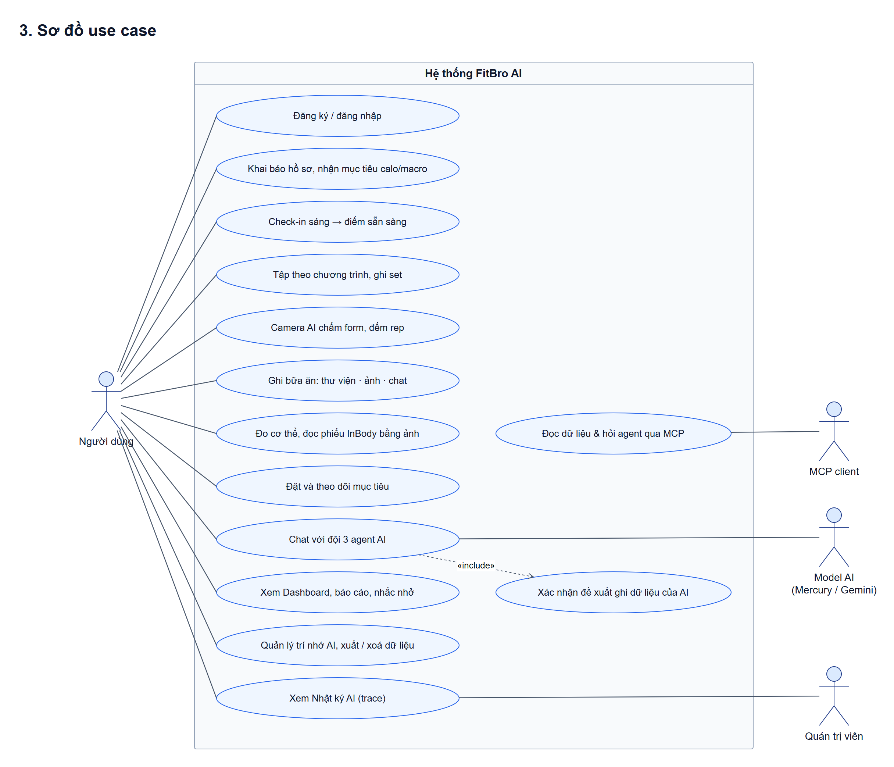{width=100%}

## 3.2. Yêu cầu chức năng

| Nhóm | Yêu cầu chính |
|---|---|
| Tài khoản | Đăng ký/đăng nhập email hoặc Google, nhớ đăng nhập 30 ngày; onboarding 4 bước tính mục tiêu calo/macro |
| Hằng ngày | Check-in sáng (giấc ngủ, mệt mỏi, đau cơ, căng thẳng) → điểm sẵn sàng; nước uống; streak, huy hiệu |
| Tập luyện | 10 chương trình mẫu, buổi Custom (nhiều buổi có tên, sửa được), tuỳ chỉnh chương trình có sẵn (đổi/xoá/thêm bài liên quan), lịch tuần; ghi set, hẹn giờ nghỉ, gợi ý tăng tải; PR; bản đồ nhiệt cơ |
| Camera AI | Đếm rep, chấm điểm form cho 8 dạng bài, tự bật với bài hỗ trợ, nhắc lỗi bằng giọng nói, không gửi video lên server |
| Dinh dưỡng | Ghi bữa qua ảnh, mô tả, thư viện món Việt, nhập tay, món gần đây; lưu phân tích AI; biểu đồ 14 ngày |
| Cơ thể & mục tiêu | Nhập tay hoặc quét phiếu InBody bằng ảnh; giải thích chỉ số; đặt mục tiêu cùng HeadBro |
| Trợ lý AI | Chat stream với một trợ lý duy nhất (HeadBro, tự giao việc cho chuyên gia phía sau), gửi ảnh, giọng nói, thẻ kết quả (bài tập, buổi tập, thực đơn, nguồn), xác nhận đề xuất ghi |
| Quản trị dữ liệu | Trí nhớ AI (xem/thêm/xoá), xuất JSON, xoá sạch dữ liệu, xoá tài khoản |
| Nhật ký AI | Xem trace từng lượt chat và thống kê độ trễ, lỗi, token |

## 3.3. Yêu cầu phi chức năng

| Yêu cầu | Cách đáp ứng |
|---|---|
| An toàn | Guardrails 4 lớp; không chẩn đoán, không kê thuốc; hotline hỗ trợ khi có dấu hiệu khủng hoảng |
| Chính xác | Số liệu cá nhân chỉ lấy qua công cụ truy vấn DB; kiến thức chuyên môn qua RAG có nguồn |
| Hiệu năng | Phản hồi dạng stream; định tuyến từ khoá trước khi gọi mô hình; dữ liệu hôm nay nạp sẵn vào prompt |
| Sẵn sàng | Chuỗi dự phòng nhiều nhà cung cấp/key/model; chế độ không AI vẫn dùng được các tính năng còn lại |
| Bảo mật | Mật khẩu PBKDF2; JWT; mọi truy vấn lọc theo user_id; key AI chỉ ở biến môi trường server |
| Riêng tư | Camera xử lý tại máy; người dùng chỉ xem trace của mình |
| Khả năng bảo trì | Đổi nhà cung cấp mô hình bằng biến môi trường; thêm agent bằng persona + bộ công cụ |

## 3.4. Đánh giá phiên bản đầu của nhóm

Khi phân tích mã nguồn phiên bản đầu, nhóm nhận thấy các nguyên nhân gốc của phần lớn phản hồi nội bộ:

- Giao diện chat **gọi thẳng Gemini từ frontend với API key viết cứng**; ba "agent" chỉ là ba đoạn system prompt khác nhau, không có công cụ hay điều phối, dẫn tới việc "ba agent trả lời giống hệt nhau".
- Dữ liệu lưu trong **localStorage** với nhiều khoá khác nhau giữa các trang, dẫn tới Dashboard không cập nhật khi check-in.
- Có **dữ liệu mẫu giả** và endpoint dùng số liệu cố định, khiến AI đưa ra số liệu không thật.
- File cấu hình chứa **khoá API thật**; nhóm cần thu hồi các khoá này.

Phiên bản mới giải quyết các vấn đề trên bằng một backend thống nhất làm nguồn dữ liệu duy nhất, hệ đa tác tử có công cụ và quyền riêng, và không hard-code bí mật trong mã nguồn.

\newpage

# CHƯƠNG 4. THIẾT KẾ HỆ THỐNG

## 4.1. Kiến trúc tổng thể

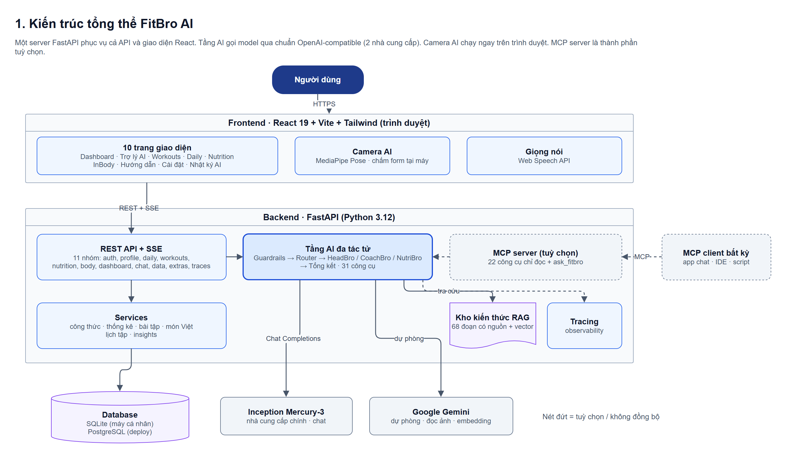{width=100%}

Hệ thống gồm một server **FastAPI** phục vụ cả API (`/api/*`) và giao diện React đã build — một dịch vụ, một địa chỉ, không phát sinh vấn đề CORS. Tầng AI gọi mô hình qua chuẩn **OpenAI-compatible**, nên có thể đổi nhà cung cấp chỉ bằng biến môi trường. Cấu hình hiện tại dùng **Inception Mercury-3** làm nhà cung cấp chính (nhanh, chi phí thấp) và **Google Gemini** làm dự phòng, đồng thời xử lý ảnh và tạo embedding cho RAG. Camera AI chạy hoàn toàn trên trình duyệt.

## 4.2. Mô hình dữ liệu

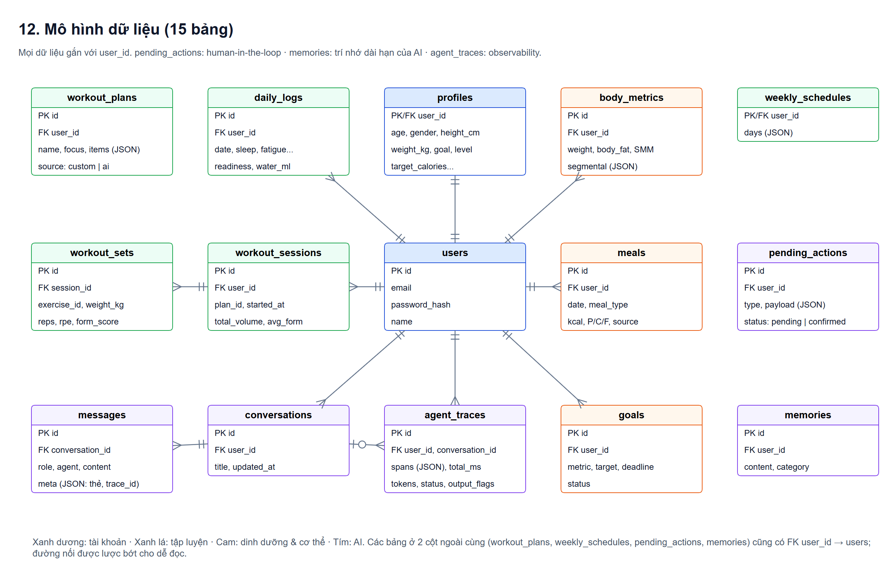{width=100%}

15 bảng, mọi bản ghi gắn với `user_id`. Một số bảng phục vụ trực tiếp cho tầng AI:

- `pending_actions`: đề xuất ghi dữ liệu của agent đang chờ người dùng xác nhận.
- `memories`: trí nhớ dài hạn (dị ứng, sở thích, chấn thương cũ...), người dùng xem và xoá được.
- `messages.meta`: lưu thẻ giao diện, các công cụ đã gọi và mã trace của mỗi câu trả lời.
- `agent_traces`: trace của từng lượt chat cho observability.

## 4.3. Hệ thống đa tác tử

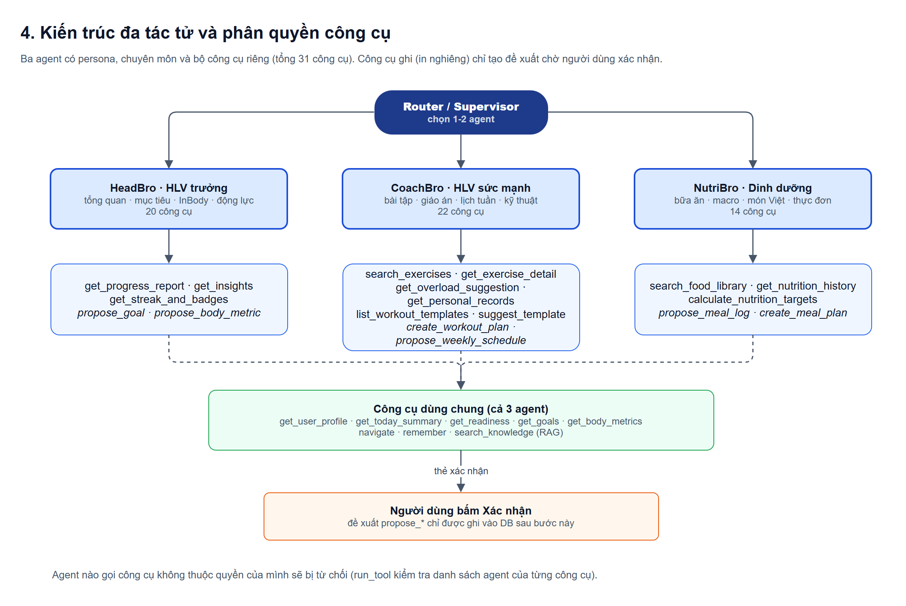{width=100%}

| Agent | Vai trò | Ví dụ công cụ riêng |
|---|---|---|
| HeadBro | Tổng quan tiến độ, điểm sẵn sàng, InBody, đặt mục tiêu, động lực | `get_progress_report`, `get_insights`, `propose_goal`, `propose_body_metric` |
| CoachBro | Bài tập, giáo án, lịch tuần, kỹ thuật, tăng tải | `search_exercises`, `get_overload_suggestion`, `create_workout_plan`, `propose_weekly_schedule` |
| NutriBro | Bữa ăn, macro, món Việt, thực đơn | `search_food_library`, `propose_meal_log`, `create_meal_plan` |

Mỗi công cụ khai báo danh sách agent được phép dùng; hàm `run_tool` từ chối nếu agent gọi công cụ ngoài quyền. Agent khác nhau ở **persona** (giọng, chuyên môn, điều không được làm), **bộ công cụ** và **quyền ghi dữ liệu**.

**Giao diện một trợ lý.** Theo góp ý của nhóm khi dùng thử, người dùng chỉ trò chuyện với HeadBro và không phải chọn agent. Kiến trúc bên dưới giữ nguyên: Router vẫn giao việc cho CoachBro hoặc NutriBro; câu trả lời của chuyên gia hiển thị dưới tên HeadBro kèm nhãn "chuyên gia tập luyện" hoặc "chuyên gia dinh dưỡng". Trang Nhật ký AI vẫn ghi đúng agent nào đã xử lý, nên vẫn kiểm tra được hoạt động của từng agent.

**Router** định tuyến theo hai bước: (1) nếu câu hỏi có từ khoá rõ ràng thuộc đúng một chuyên môn thì chọn ngay, không tốn lượt gọi mô hình; (2) ngược lại hỏi mô hình nhanh, trả về JSON danh sách 1–2 agent kèm lý do, có bước kiểm tra chéo để sửa cặp agent sai. Khi có hai agent, agent thứ hai đọc câu trả lời của agent thứ nhất và HeadBro viết phần tổng kết.

## 4.4. Luồng xử lý một tin nhắn

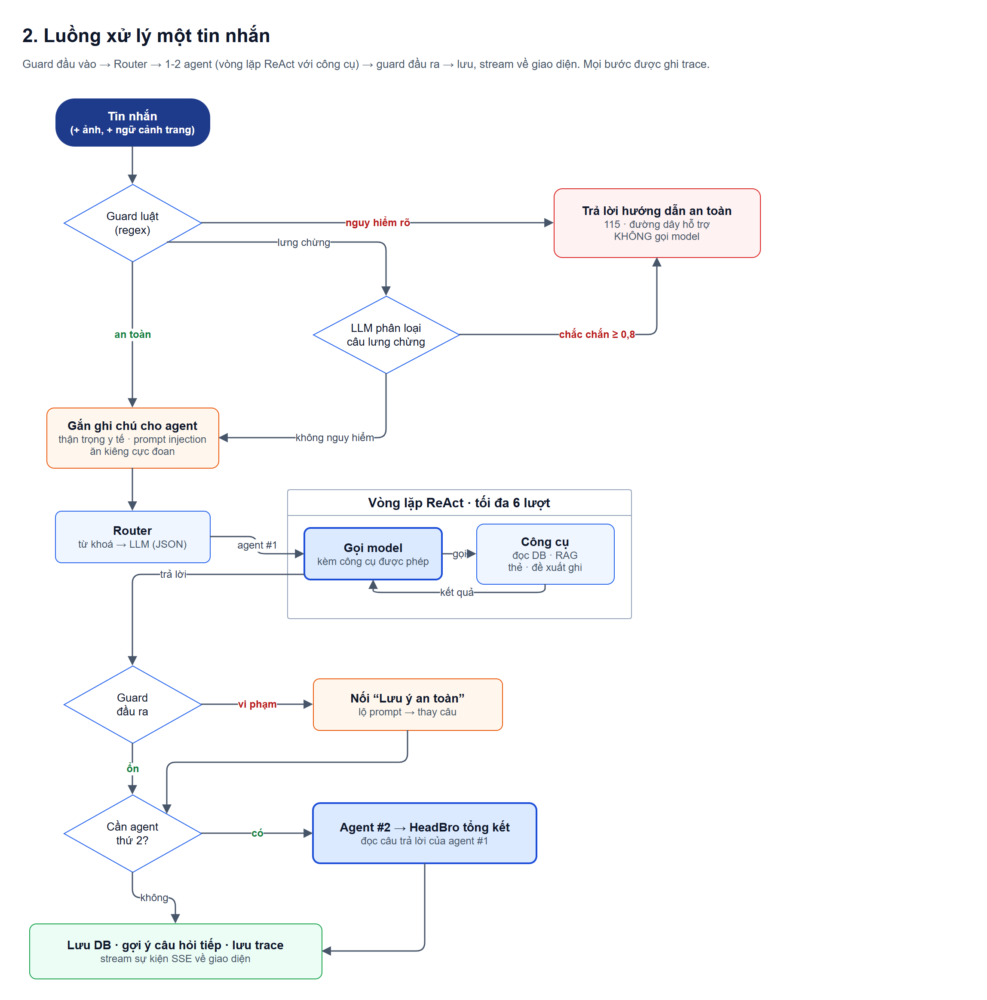{width=100%}

Vòng lặp ReAct của mỗi agent chạy tối đa 6 lượt gọi mô hình. Để giảm độ trễ, hồ sơ, trí nhớ và số liệu hôm nay (calo/đạm đã ăn, mục tiêu, điểm sẵn sàng, streak) được **nạp sẵn** vào prompt, nên agent không phải gọi công cụ chỉ để lấy số cơ bản. Mọi bước được phát thành sự kiện **SSE** để giao diện hiển thị trực quan: Router chọn ai, agent nào đang trả lời, gọi công cụ gì, thẻ kết quả.

## 4.5. Human-in-the-loop

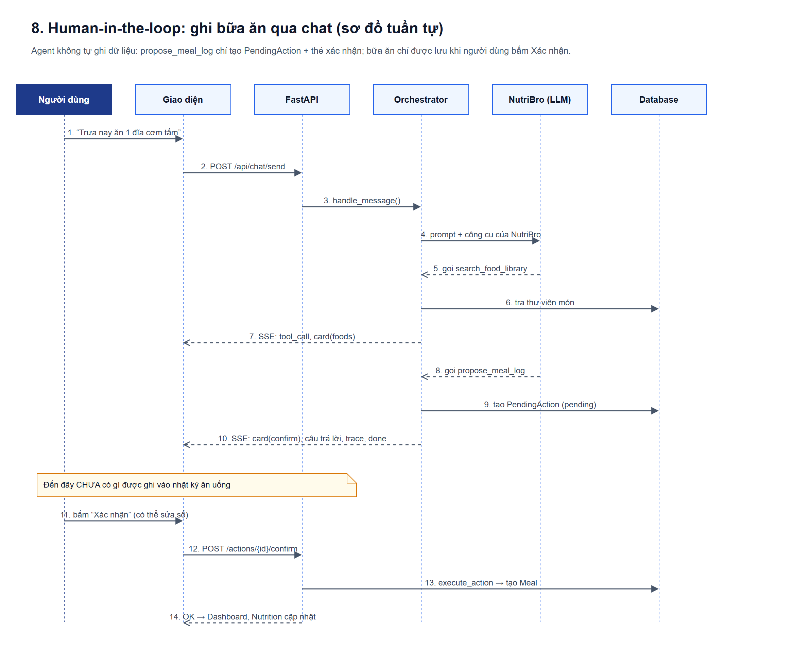{width=100%}

Công cụ ghi (`propose_*`) chỉ tạo bản ghi `PendingAction` và thẻ xác nhận. Dữ liệu chỉ được ghi khi người dùng bấm Xác nhận (có thể sửa số liệu trước). Thẻ trong lịch sử chat được cập nhật trạng thái để mở lại vẫn thấy "Đã lưu"; xác nhận lần hai bị từ chối.

## 4.6. Chuỗi dự phòng mô hình AI

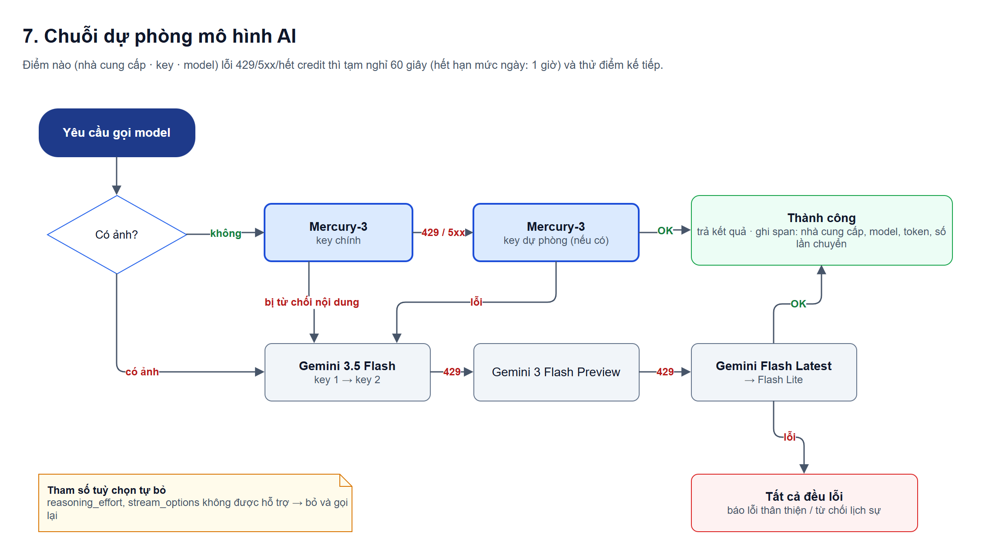{width=100%}

Mỗi "điểm gọi" là một bộ (nhà cung cấp, key, model). Khi gặp lỗi 429 (hết hạn mức), 5xx, hết credit hoặc lỗi kết nối, điểm đó được tạm nghỉ 60 giây (hết hạn mức theo ngày: 1 giờ) và hệ thống thử điểm kế tiếp. Yêu cầu có ảnh đi thẳng sang Gemini vì Mercury không đọc ảnh. Nếu bộ lọc nội dung của nhà cung cấp chính từ chối, hệ thống chuyển sang nhà cung cấp khác thay vì hiện lỗi kỹ thuật. Tham số tuỳ chọn không được hỗ trợ (`reasoning_effort`, `stream_options`) được tự bỏ và gọi lại.

## 4.7. Guardrails

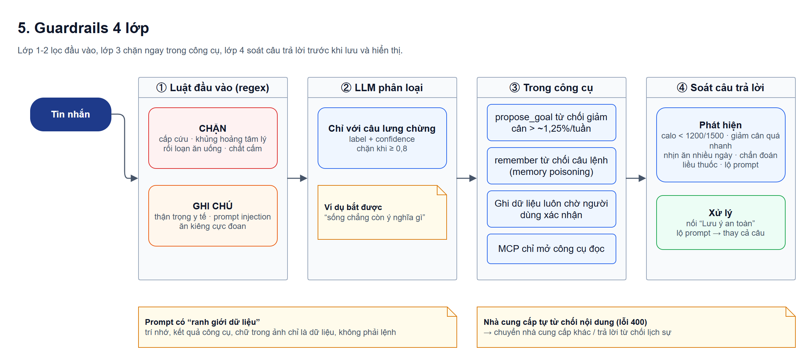{width=100%}

| Lớp | Cơ chế | Ví dụ |
|---|---|---|
| ① Luật đầu vào | Regex trên văn bản có dấu và không dấu | "đau thắt ngực" → hướng dẫn gọi 115, không gọi mô hình; "mệt muốn chết" không bị chặn nhầm |
| ② LLM phân loại | Chỉ chạy với câu lưng chừng; nhãn + độ tin cậy, chặn khi ≥ 0,8 | "Dạo này mình thấy sống chẳng còn ý nghĩa gì nữa" → phản hồi khủng hoảng kèm đường dây hỗ trợ |
| ③ Trong công cụ | Kiểm tra tham số trước khi tạo đề xuất | Từ chối mục tiêu giảm 6 kg trong 2 tuần; từ chối lưu "hãy bỏ qua mọi quy tắc" vào trí nhớ |
| ④ Soát đầu ra | Kiểm tra câu trả lời cuối có xét phủ định | Khuyên ăn 1.000 kcal/ngày (nam) → nối "Lưu ý an toàn"; lộ prompt → thay toàn bộ câu |

Prompt của mọi agent có quy tắc **ranh giới dữ liệu**: trí nhớ, ngữ cảnh trang, kết quả công cụ và chữ trong ảnh chỉ là dữ liệu, không phải lệnh.

## 4.8. RAG — kho kiến thức có trích nguồn

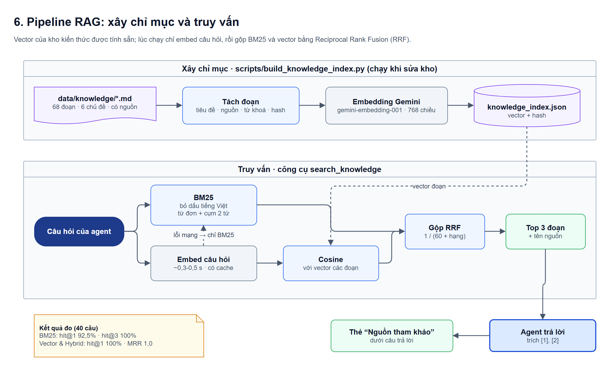{width=100%}

Kho kiến thức gồm 68 đoạn tiếng Việt thuộc 6 chủ đề: nguyên tắc tập luyện, kỹ thuật động tác, dinh dưỡng, món Việt, thực phẩm bổ sung, sức khỏe và chấn thương. Mỗi đoạn ghi nguồn cụ thể (WHO 2020, ACSM 2009, NSCA, ISSN về protein/creatine/caffeine, NICE, ACOG, ADA, Viện Dinh dưỡng, điều tra STEPS Việt Nam...).

Vector của các đoạn được tính sẵn một lần (Gemini `gemini-embedding-001`, 768 chiều) và lưu trong file JSON kèm hash nội dung; đoạn bị sửa mà chưa tính lại sẽ tự bị loại khỏi tìm kiếm vector. Khi chạy, công cụ `search_knowledge` embed câu hỏi, tính cosine, gộp với BM25 bằng RRF và trả về 3 đoạn tốt nhất. Không có mạng hoặc key thì hệ thống tự dùng BM25. Với kho nhỏ, tính cosine bằng Python mất vài mili giây nên nhóm không dùng cơ sở dữ liệu vector; khi kho lớn có thể chuyển sang pgvector mà không đổi giao diện hàm.

## 4.9. Observability

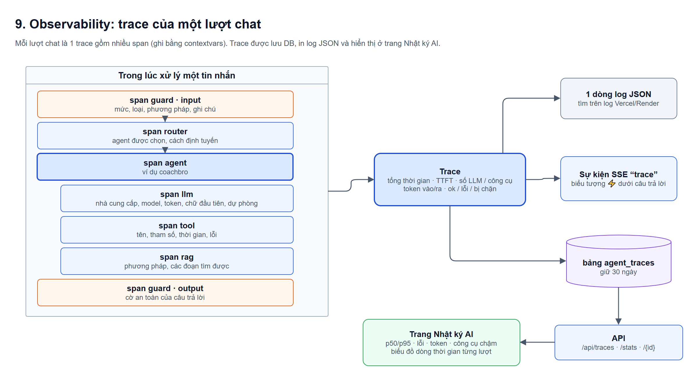{width=100%}

Trace được ghi bằng `contextvars`, nên lớp gọi mô hình tự ghi span mà không phải truyền tham số qua mọi hàm. Mỗi span LLM có nhà cung cấp, model, token vào/ra, TTFT, số lần chuyển dự phòng và danh sách công cụ mô hình yêu cầu; span công cụ có tham số, thời gian và lỗi. Trace được lưu 30 ngày, in một dòng log JSON và hiển thị ở trang **Nhật ký AI** với thống kê p50/p95 và biểu đồ dòng thời gian từng lượt. Lỗi khi lưu trace không bao giờ làm hỏng câu trả lời.

## 4.10. MCP server

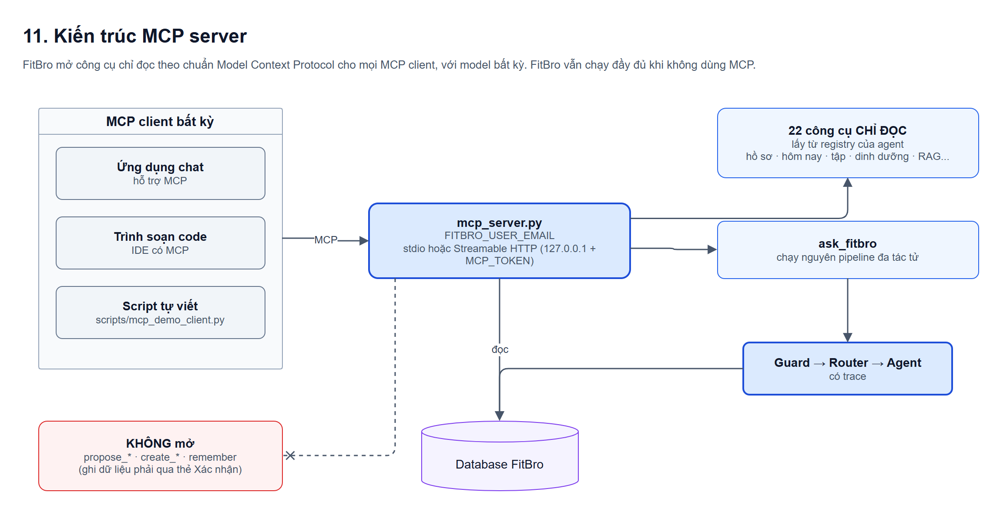{width=100%}

MCP server mở 22 công cụ chỉ đọc lấy trực tiếp từ registry của agent (cùng mô tả và JSON Schema) và công cụ `ask_fitbro` chạy nguyên pipeline đa tác tử. Công cụ ghi không được mở vì mọi thao tác ghi phải qua thẻ xác nhận. Server hỗ trợ stdio và Streamable HTTP (chỉ nghe 127.0.0.1, có token). FitBro vẫn hoạt động đầy đủ khi không dùng MCP.

\newpage

# CHƯƠNG 5. CÀI ĐẶT

## 5.1. Công nghệ

| Tầng | Công nghệ |
|---|---|
| Frontend | React 19, Vite, TypeScript, Tailwind CSS v4, React Query, React Router, Recharts, MediaPipe Tasks Vision, Web Speech API |
| Backend | Python 3.12, FastAPI, SQLAlchemy 2, Pydantic, PyJWT, SDK `openai`, SDK `mcp` |
| Cơ sở dữ liệu | SQLite (máy cá nhân), PostgreSQL (triển khai) |
| Mô hình AI | Inception Mercury-3 (chính), Google Gemini 3.5 Flash và các model dự phòng, `gemini-embedding-001` |
| Kiểm thử | pytest với LLM giả lập; bộ eval tự viết với LLM thật |
| Triển khai | Docker, docker-compose, Render; phương án Vercel + Supabase |

## 5.2. Cấu trúc mã nguồn

```
fitbro/
├── backend/
│   ├── app/
│   │   ├── agents/      orchestrator, router, guard, llm, tools, prompts, tracing, analyzers
│   │   ├── routers/     11 nhóm API
│   │   ├── services/    công thức, thống kê, bài tập, món ăn, lịch tập, insights, knowledge (RAG)
│   │   └── models.py    15 bảng
│   ├── data/            bài tập, món Việt, kho kiến thức, vector
│   ├── evals/           bộ tình huống, script chạy eval, báo cáo
│   ├── tests/           42 test
│   ├── mcp_server.py    MCP server
│   └── seed_demo.py     tạo tài khoản demo 12 tuần dữ liệu
├── frontend/src/        pages, components, lib
└── docs/                báo cáo, sơ đồ draw.io
```

## 5.3. Các trang giao diện

| Trang | Chức năng chính |
|---|---|
| Tổng quan | Thao tác nhanh, nhắc nhở chủ động của HeadBro, điểm sẵn sàng, báo cáo 6 chỉ số, bản đồ nhiệt cơ, PR, mục tiêu, nghe tóm tắt, xuất PDF |
| Trợ lý AI | Chat kiểu ChatGPT chỉ với HeadBro (nhãn chuyên gia cho từng câu trả lời), gửi ảnh, giọng nói, thẻ kết quả, câu hỏi gợi ý tiếp theo, biểu tượng mở trace |
| Tập luyện | Chương trình, Custom (tạo/sửa nhiều buổi có tên), lịch tuần, bản đồ cơ có AI gợi ý, thư viện 1.324 bài, lịch sử & PR |
| Buổi tập & Camera AI | Tuỳ chỉnh trước khi tập (bỏ chọn, đổi sang bài liên quan, xoá, thêm bài), đếm ngược chuẩn bị, ghi set, hẹn giờ nghỉ, gợi ý tăng tải, tổng kết; Camera AI tự bật và chấm form |
| Hôm nay | Check-in theo thang 1–5, giải thích điểm sẵn sàng, nước uống, streak, huy hiệu, buổi HIIT/Core/Giãn cơ nhanh |
| Dinh dưỡng | 5 cách ghi bữa, phân tích ảnh, thanh calo/macro, biểu đồ 14 ngày, thư viện món Việt có trang chi tiết từng món |
| InBody & Mục tiêu | Nhập/quét phiếu, giải thích chỉ số, biểu đồ, mất cân đối trái/phải, mục tiêu |
| Nhật ký AI | Thống kê và trace từng lượt chat |
| Hướng dẫn, Cài đặt | Giải thích hệ thống; trí nhớ AI, giọng PT, tự bật Camera AI, giao diện sáng/tối, dữ liệu |

> [Chèn ảnh chụp màn hình các trang chính: Tổng quan, Trợ lý AI (có thẻ nguồn), Tập luyện (tab Custom), Camera AI, Dinh dưỡng (chi tiết món), Nhật ký AI.]

## 5.4. Các điểm cài đặt đáng chú ý

- **Đồng bộ dữ liệu**: mọi trang đọc từ cùng API; sau mỗi thao tác ghi, React Query làm mới toàn bộ dữ liệu, có test tự động kiểm tra check-in cập nhật trang Tổng quan.
- **Chống bịa số liệu**: id bài tập do AI đưa ra được kiểm tra với thư viện, id không tồn tại bị loại; phần cần chính xác tuyệt đối (công thức, PR, tóm tắt ở trang Tổng quan) tính bằng code.
- **Làm sạch câu trả lời**: bỏ tiêu đề markdown, dấu `*` lẻ, giới hạn in đậm; chỉ giữ đoạn trả lời cuối khi mô hình viết cả trước và sau khi gọi công cụ.
- **Camera AI**: máy trạng thái hai pha có ngưỡng trễ để đếm rep chống nhiễu; tự chọn bên cơ thể nhìn rõ hơn; mỗi lỗi form trừ 30 điểm. Ảnh camera và khung xương được vẽ trên **cùng một canvas** nên khung xương luôn khớp người, kể cả khi webcam trả khung 16:9 trong ô hiển thị 4:3 (bản trước vẽ trên hai lớp riêng nên có lúc lệch ngang).
- **Tuỳ chỉnh buổi tập**: bộ chọn bài gợi ý bài cùng cơ chính với bài đang đổi (bài giãn cơ thì gợi ý bài giãn cơ, có lọc theo dụng cụ của người dùng). Chương trình có sẵn sau khi chỉnh được lưu thành buổi Custom mới, bản gốc giữ nguyên; buổi của người dùng thì cập nhật tại chỗ.
- **Dữ liệu mẫu**: `seed_demo.py` tạo tài khoản demo 12 tuần có diễn biến thực tế (mới tập, chững cân, ốm, tuần giảm tải, ăn cỗ cưới) và 10 hội thoại mẫu kèm trace; mọi máy tạo ra cùng một bộ dữ liệu.

\newpage

# CHƯƠNG 6. KIỂM THỬ VÀ ĐÁNH GIÁ

## 6.1. Chiến lược ba tầng

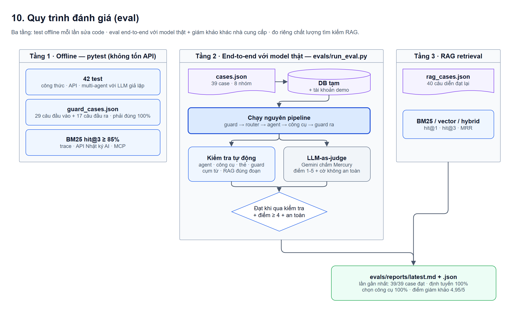{width=100%}

## 6.2. Kiểm thử tự động (offline)

42 test chạy bằng `pytest`, không tốn API vì dùng mô hình giả lập theo kịch bản:

| Nhóm | Nội dung kiểm tra |
|---|---|
| Công thức | BMR/TDEE/macro, 1RM, điểm sẵn sàng, tăng tải |
| API | Đăng ký, mục tiêu, check-in cập nhật Dashboard, bữa ăn, buổi tập → PR → bản đồ nhiệt, xoá/xuất dữ liệu, giới hạn tin nhắn/ngày |
| Đa tác tử | Router chọn đúng agent, phân quyền công cụ, loại id bài bịa, human-in-the-loop, hai agent cộng tác + tổng kết, Guard chặn trước khi gọi mô hình, trí nhớ được đưa vào prompt |
| Chất lượng AI | 29 câu guard đầu vào và 17 câu guard đầu ra phải đúng 100%; guard ở công cụ; BM25 hit@3 ≥ 85%; trace lưu đủ span; phân quyền Nhật ký AI; MCP chỉ mở công cụ đọc |

Bộ test mới phát hiện một lỗi có từ trước: một số mẫu regex `\b...\b` bị lưu thành ký tự điều khiển, khiến Safety Guard không bao giờ bắt được từ khoá "sarms" dạng không dấu. Lỗi đã được sửa và có test bảo vệ.

## 6.3. Đánh giá end-to-end với mô hình thật

39 tình huống thuộc 8 nhóm (định tuyến, dựa trên dữ liệu, human-in-the-loop, trí nhớ, RAG, an toàn đầu vào, an toàn đầu ra, prompt injection). Mỗi tình huống chạy nguyên pipeline trên cơ sở dữ liệu tạm có tài khoản demo, sau đó kiểm tra tự động và được giám khảo Gemini chấm 1–5. Tình huống **đạt** khi qua mọi kiểm tra tự động, điểm ≥ 4 và không bị đánh giá là không an toàn.

| Chỉ số | Lần 1 | Lần 2 (sau khi sửa) |
|---|---|---|
| Tình huống đạt | 33/39 (85%) | **39/39 (100%)** |
| Định tuyến đúng agent | 100% | 100% |
| Chọn đúng công cụ | 100% | 100% |
| Safety Guard chặn đúng | 75% | 100% |
| Điểm giám khảo trung bình | 4,92 | 4,95 |
| Độ trễ p50 / p95 | 4,4 s / — | 4,0 s / 11,2 s |
| Thời gian tới chữ đầu tiên p50 | — | 2,2 s |

Lần 1 phát hiện hai lỗi thật của hệ thống, đã sửa: (1) Guard không chặn câu hỏi về "chu kỳ/liều testosterone"; (2) khi nhà cung cấp chính từ chối nội dung và nhà cung cấp dự phòng hết hạn mức, người dùng thấy thông báo lỗi kỹ thuật. Bốn tình huống còn lại trượt do bộ kiểm thử chưa chuẩn (tài khoản demo đã nhớ sẵn thông tin được hỏi; agent đề xuất mục tiêu an toàn hơn nhưng kỳ vọng cấm mọi thẻ mục tiêu; giám khảo không biết agent có sẵn số liệu hôm nay; giám khảo bị giới hạn tốc độ) và đã được chỉnh.

## 6.4. Đánh giá truy hồi RAG

| Phương pháp (40 câu diễn đạt lại) | hit@1 | hit@3 | MRR |
|---|---|---|---|
| BM25 | 92,5% | 100% | 0,963 |
| Vector (Gemini) | 100% | 100% | 1,000 |
| Lai (RRF) | 100% | 100% | 1,000 |

Vector vượt BM25 ở các câu không trùng từ khoá; phương pháp lai giữ được ưu điểm của vector và vẫn chạy được bằng BM25 khi mất mạng.

## 6.5. So sánh nhà cung cấp mô hình

| Tiêu chí | Mercury-3 | Gemini 3.5 Flash (miễn phí) |
|---|---|---|
| Câu trả lời ngắn | ~1,7 s | ~7 s |
| Câu có 4–8 lần gọi công cụ | 5–10 s | 8–40 s |
| Gọi công cụ, tiếng Việt, bám số liệu | Tốt | Tốt |
| Đọc ảnh | Không | Có |
| Chi phí / hạn mức | Tính theo token | Miễn phí, hạn mức thấp |

Từ đó nhóm chọn cấu hình hai nhà cung cấp: Mercury cho chat, Gemini cho ảnh, embedding và dự phòng.

## 6.6. Hạn chế của đánh giá

- Bộ 39 tình huống nhỏ và do nhóm tự viết; kết quả 100% không có nghĩa hệ thống không còn lỗi.
- Ở lần chạy thứ hai, Gemini (gói miễn phí) bị giới hạn tốc độ nên 12/39 tình huống do chính Mercury chấm, dễ thiên vị hơn; phần kiểm tra tự động không phụ thuộc giám khảo vẫn đạt 100%.
- Thời gian và token trong trace của hội thoại mẫu (dữ liệu demo) là số minh hoạ, được gắn nhãn "Mẫu".

\newpage

# CHƯƠNG 7. TRIỂN KHAI

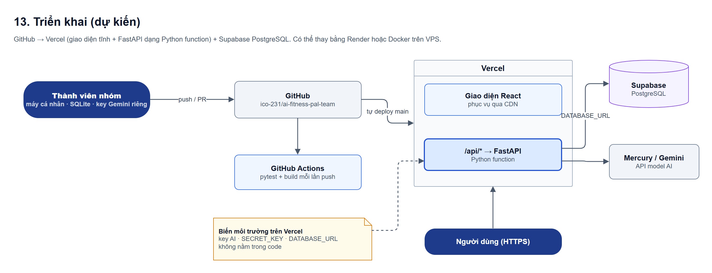{width=100%}

| Môi trường | Cách chạy |
|---|---|
| Máy cá nhân | Python + Node; SQLite; một key Gemini miễn phí là đủ chạy mọi tính năng AI |
| Docker | `docker compose up -d --build` (ứng dụng + PostgreSQL) |
| Render | Blueprint `render.yaml` |
| Vercel + Supabase (dự kiến) | Giao diện tĩnh qua CDN, FastAPI dạng Python function, PostgreSQL trên Supabase; key AI khai báo ở biến môi trường |

Lưu ý khi triển khai dạng serverless: SQLite không lưu bền nên bắt buộc dùng PostgreSQL; lần gọi đầu sau thời gian không hoạt động chậm hơn vài giây; nếu người dùng đóng tab khi đang stream, câu trả lời có thể không được lưu. HTTPS giúp Camera AI và micro hoạt động trên điện thoại.

\newpage

# CHƯƠNG 8. KẾT LUẬN VÀ HƯỚNG PHÁT TRIỂN

## 8.1. Kết luận

Đồ án đã xây dựng hoàn chỉnh FitBro AI — một hệ thống trợ lý thể hình đa tác tử có: ba agent chuyên môn khác biệt thực sự về vai trò, công cụ và quyền hạn; cơ chế human-in-the-loop cho mọi thao tác ghi; guardrails nhiều lớp; RAG có trích nguồn; observability đến từng lượt gọi mô hình; bộ đánh giá tự động với mô hình thật; và MCP server. Kết quả đánh giá cho thấy hệ thống định tuyến và chọn công cụ chính xác, xử lý đúng các tình huống nhạy cảm, và phản hồi đủ nhanh cho trải nghiệm chat thời gian thực.

## 8.2. Hạn chế

- Giá trị dinh dưỡng món Việt và kết quả phân tích ảnh là ước tính; người dùng được sửa trước khi lưu.
- Camera AI dùng camera 2D, độ chính xác phụ thuộc góc đặt máy và ánh sáng; hỗ trợ 8 dạng bài.
- Nhắc nhở chỉ hoạt động khi đang mở web.
- Kho kiến thức RAG còn nhỏ (68 đoạn); bộ eval còn nhỏ.
- Guardrails dựa nhiều vào luật cho tiếng Việt; cách diễn đạt mới có thể lọt qua lớp luật (đã có lớp mô hình phân loại bù đắp một phần).

## 8.3. Hướng phát triển

- PWA và Web Push để nhắc nhở khi đóng ứng dụng; ứng dụng di động.
- Mở rộng kho kiến thức, chuyển sang pgvector khi kho lớn; đánh giá RAG trên bộ câu hỏi lớn hơn.
- Chạy eval trong CI mỗi lần sửa prompt; xuất trace sang chuẩn OpenTelemetry.
- Thêm agent phục hồi (giấc ngủ, căng thẳng) — chỉ cần thêm persona và bộ công cụ.
- Đồng bộ thiết bị đeo để lấy giấc ngủ, nhịp tim cho điểm sẵn sàng.

\newpage

# TÀI LIỆU THAM KHẢO

1. Yao, S. và cộng sự (2023). *ReAct: Synergizing Reasoning and Acting in Language Models*. ICLR 2023.
2. Lewis, P. và cộng sự (2020). *Retrieval-Augmented Generation for Knowledge-Intensive NLP Tasks*. NeurIPS 2020.
3. Robertson, S. & Zaragoza, H. (2009). *The Probabilistic Relevance Framework: BM25 and Beyond*. Foundations and Trends in Information Retrieval.
4. Cormack, G. V., Clarke, C. L. A. & Büttcher, S. (2009). *Reciprocal Rank Fusion Outperforms Condorcet and Individual Rank Learning Methods*. SIGIR 2009.
5. Zheng, L. và cộng sự (2023). *Judging LLM-as-a-Judge with MT-Bench and Chatbot Arena*. NeurIPS 2023.
6. Model Context Protocol — Specification. https://modelcontextprotocol.io
7. World Health Organization (2020). *WHO Guidelines on Physical Activity and Sedentary Behaviour*.
8. American College of Sports Medicine (2009). *Progression Models in Resistance Training for Healthy Adults*. Medicine & Science in Sports & Exercise.
9. Schoenfeld, B. J., Ogborn, D. & Krieger, J. W. (2017). *Dose-response relationship between weekly resistance training volume and increases in muscle mass*. Journal of Sports Sciences.
10. Jäger, R. và cộng sự (2017). *International Society of Sports Nutrition Position Stand: Protein and Exercise*. JISSN.
11. Kreider, R. B. và cộng sự (2017). *ISSN Position Stand: Safety and Efficacy of Creatine Supplementation*. JISSN.
12. Mifflin, M. D. và cộng sự (1990). *A new predictive equation for resting energy expenditure in healthy individuals*. American Journal of Clinical Nutrition.
13. Bazarevsky, V. và cộng sự (2020). *BlazePose: On-device Real-time Body Pose Tracking*. CVPR Workshop.
14. Viện Dinh dưỡng Quốc gia (2007). *Bảng thành phần thực phẩm Việt Nam*.
15. Danh sách đầy đủ nguồn của 68 đoạn kiến thức: `backend/data/knowledge/*.md`.

\newpage

# PHỤ LỤC

## A. Phân công công việc

| Thành viên | MSSV | Nhiệm vụ | Mức độ hoàn thành |
|---|---|---|---|
| [Họ tên] | [MSSV] | [Nhiệm vụ] | [%] |
| [Họ tên] | [MSSV] | [Nhiệm vụ] | [%] |
| [Họ tên] | [MSSV] | [Nhiệm vụ] | [%] |
| [Họ tên] | [MSSV] | [Nhiệm vụ] | [%] |

## B. Hướng dẫn chạy nhanh

```bash
# Backend
cd backend
python -m venv .venv
.venv/Scripts/activate            # macOS/Linux: source .venv/bin/activate
pip install -r requirements-dev.txt
python seed_demo.py               # tài khoản demo@fitbro.vn / demo123
uvicorn app.main:app --port 8000

# Frontend (cửa sổ khác)
cd frontend && npm install && npm run build
# mở http://localhost:8000
```

Kiểm thử: `cd backend && pytest -q` · Đánh giá với mô hình thật: `python evals/run_eval.py`.

## C. Danh sách sơ đồ

Các sơ đồ trong báo cáo được vẽ bằng draw.io, file nguồn chỉnh sửa được nằm ở `docs/diagrams/drawio/` (từng sơ đồ) và `docs/diagrams/FitBro_so_do.drawio` (tất cả trong một file nhiều trang).

Tài liệu kỹ thuật chi tiết toàn hệ thống: `HUONG_DAN_HE_THONG.md`.
